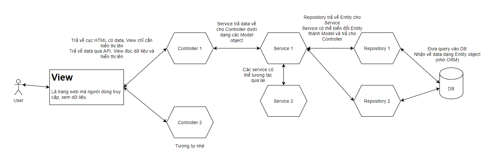

# Khởi tạo dự án SpringBoot

# 1\. Khởi tạo một dự án Spring Boot

## 1.1. Spring Boot là gì?

**Spring Boot** là framework dựa trên Spring, giúp tạo ứng dụng Java nhanh hơn nhờ:

- Tự động cấu hình.
- Quản lý dependency.
- Server nhúng như Tomcat.
- Có thể đóng gói ứng dụng thành file `.jar` để chạy độc lập.

Trong bài này sử dụng:

```
Java 21
IntelliJ IDEA
Maven
Spring Boot
Packaging: JAR
```

---

# 2\. Spring Initializr

## 2.1. Spring Initializr là gì?

**Spring Initializr** là công cụ tạo sẵn bộ khung cho một project Spring Boot.

IntelliJ IDEA có tích hợp trực tiếp Spring Initializr nên có thể tạo project ngay trong IDE. JetBrains hiện cũng hướng dẫn tạo Spring Boot Maven project trực tiếp bằng **File → New → Project → Spring Boot**.


Có 2 cách tạo:

```
Cách 1:
IntelliJ IDEA
    ↓
Spring Boot Project

Cách 2:
start.spring.io
    ↓
Generate
    ↓
Download project
    ↓
Mở bằng IntelliJ
```

Với người mới học, có thể dùng trực tiếp **IntelliJ IDEA**.

---

# 3\. Tạo project Spring Boot bằng IntelliJ

## 3.1. Mở Spring Boot Project

Trong IntelliJ:

```
File
  ↓
New
  ↓
Project
  ↓
Spring Boot
```

Hoặc nếu đang ở màn hình Welcome:

```
New Project
    ↓
Spring Boot
```

Đây là Spring Boot Project Wizard được IntelliJ tích hợp với Spring Initializr.

---

## 3.2. Điền thông tin project

Ví dụ tạo project:

```
Name: demo
Language: Java
Type: Maven
Group: com.example
Artifact: demo
Package name: com.example.demo
JDK: 21
Packaging: JAR
```

Minh họa các trường quan trọng:


### Ý nghĩa

| Trường       | Ý nghĩa              | Ví dụ              |
| ------------ | -------------------- | ------------------ |
| Name         | Tên project          | `demo`             |
| Language     | Ngôn ngữ             | `Java`             |
| Type         | Build tool           | `Maven`            |
| Group        | Nhóm/tổ chức         | `com.example`      |
| Artifact     | Tên artifact/project | `demo`             |
| Package name | Package Java gốc     | `com.example.demo` |
| JDK          | Phiên bản Java       | `21`               |
| Packaging    | Kiểu đóng gói        | `JAR`              |

### Quan trọng

Với project của bạn:

```
JDK       → 21
Type      → Maven
Packaging → JAR
```

---

# 4\. Chọn Spring Boot version

Sau khi điền thông tin project, IntelliJ cho phép chọn phiên bản Spring Boot.

Ví dụ:

```
Spring Boot
    4.x.x
```

hoặc phiên bản phù hợp mà IntelliJ đang cung cấp.

Không nên tự chọn một version bất kỳ trên mạng. Khi tạo project mới, nên chọn version mà **Spring Initializr/IntelliJ cung cấp và tương thích với JDK đang sử dụng**.

---

# 5\. Chọn Dependencies

Dependency là các thư viện mà project cần sử dụng.

Ví dụ project web cơ bản có thể chọn:

```
Spring Web
Thymeleaf
Lombok
```

Trong bước khởi tạo, nếu mục tiêu chỉ là kiểm tra project chạy được thì **Spring Web** là đủ.


5

## 5.1. Spring Web

Dùng để xây dựng ứng dụng web và REST API.

```
Spring Web
```

## 5.2. Thymeleaf

Dùng khi muốn tạo giao diện HTML phía server.

```
Thymeleaf
```

## 5.3. Lombok

Giúp giảm code lặp như getter, setter, constructor...

```
Lombok
```

**Lưu ý:** Lombok, Thymeleaf... chưa cần thiết để project Spring Boot khởi động. Chúng là dependency bổ sung tùy mục đích.

---

# 6\. Create project

Sau khi chọn xong:

```
Next
    ↓
Create
```

IntelliJ sẽ tạo project và Maven bắt đầu tải các dependency.

Quá trình này có thể mất một lúc ở lần đầu vì Maven cần tải thư viện về máy.

---

# 7\. Cấu trúc project sau khi tạo

Project sẽ có cấu trúc tương tự:

```
demo
├── .mvn
├── src
│   ├── main
│   │   ├── java
│   │   │   └── com.example.demo
│   │   │       └── DemoApplication.java
│   │   │
│   │   └── resources
│   │       ├── static
│   │       ├── templates
│   │       └── application.properties
│   │
│   └── test
│
├── pom.xml
├── mvnw
└── mvnw.cmd
```


5

IntelliJ/Spring Initializr tạo sẵn build configuration, class có `main()` và file `application.properties` cho project.

---

# 8\. Các thư mục và file quan trọng

## 8.1. `src/main/java`

Đây là nơi chứa **code Java chính**.

Ví dụ:

```
src/main/java
└── com.example.demo
    └── DemoApplication.java
```

Sau này có thể tạo:

```
controller
service
repository
entity
dto
config
```

---

## 8.2. `src/main/resources`

Chứa các tài nguyên của ứng dụng.

```
resources
├── static
├── templates
└── application.properties
```

### `static`

Chứa tài nguyên tĩnh:

```
CSS
JavaScript
Images
```

### `templates`

Chứa file giao diện HTML nếu sử dụng Thymeleaf.

### `application.properties`

Chứa cấu hình ứng dụng.

Ví dụ:

properties

```
server.port=8081
```

Khi đó server chạy ở:

```
http://localhost:8081
```

---

# 9\. File `pom.xml`

Đây là **file cấu hình Maven**.

Ví dụ bên trong có:

```
<groupId>com.example</groupId>
<artifactId>demo</artifactId>
<version>0.0.1-SNAPSHOT</version>
```

Và các dependency:

```
<dependencies>

    <dependency>
        <groupId>org.springframework.boot</groupId>
        <artifactId>spring-boot-starter-web</artifactId>
    </dependency>

</dependencies>
```

Có thể hiểu đơn giản:

```
pom.xml
   │
   ├── Thông tin project
   ├── Java version
   ├── Spring Boot version
   ├── Dependencies
   └── Maven plugins
```

---

# 10\. Class khởi động Spring Boot

Project tự tạo một class dạng:

```
package com.example.demo;

import org.springframework.boot.SpringApplication;
import org.springframework.boot.autoconfigure.SpringBootApplication;

@SpringBootApplication
public class DemoApplication {

    public static void main(String[] args) {
        SpringApplication.run(DemoApplication.class, args);
    }
}
```

Đây là **class chính của ứng dụng**.

## 10.1. `main()`

Java

```
public static void main(String[] args)
```

Đây là điểm bắt đầu của chương trình Java.

---

## 10.2. `@SpringBootApplication`

Java

```
@SpringBootApplication
```

Đây là annotation chính dùng để đánh dấu class khởi động Spring Boot.

Ở phần khởi tạo project chỉ cần nhớ:

> `@SpringBootApplication` đánh dấu class chính để Spring Boot khởi động ứng dụng.

---

## 10.3. `SpringApplication.run()`

Java

```
SpringApplication.run(DemoApplication.class, args);
```

Lệnh này khởi động Spring Boot.

Với ứng dụng web, Spring Boot có thể khởi động embedded server để ứng dụng chạy trực tiếp.

---

# 11\. Chạy project lần đầu

Mở:

```
DemoApplication.java
```

Sau đó nhấn:

```
▶ Run
```

Hoặc chuột phải vào class:

```
Run 'DemoApplication'
```


Nếu chạy thành công, console sẽ xuất hiện thông tin cho biết ứng dụng đã khởi động.

Với ứng dụng web mặc định, thường truy cập:

```
http://localhost:8080
```

---

# 12\. Maven là gì?

**Maven** là build tool dùng trong project Java.

Maven giúp:

```
Quản lý dependency
       ↓
Compile
       ↓
Test
       ↓
Build
       ↓
Đóng gói JAR
```

Một số lifecycle phase thường gặp:

```
clean
compile
test
package
install
```

Trong phần này quan trọng nhất là:

```
package
```

---

# 13\. Build project thành JAR

Sau khi project chạy ổn, có thể đóng gói thành file JAR.

Trong IntelliJ:

```
Maven
  ↓
Tên project
  ↓
Lifecycle
  ↓
package
```

Double-click:

```
package
```

Hoặc dùng terminal:

Bash

```
mvn package
```

Spring Boot Maven Plugin hỗ trợ tạo executable JAR có thể chạy bằng `java -jar`.

---

# 14\. Thư mục `target`

Sau khi `package` thành công, Maven tạo:

```
target
```

Ví dụ:

```
target
├── classes
├── test-classes
└── demo-0.0.1-SNAPSHOT.jar
```

Minh họa:


File quan trọng là:

```
demo-0.0.1-SNAPSHOT.jar
```

---

# 15\. Chạy file JAR

Mở Terminal tại thư mục project:

Bash

```
java -jar target/demo-0.0.1-SNAPSHOT.jar
```

Spring Boot hỗ trợ chạy executable JAR bằng `java -jar`.

Luồng hoạt động:

```
Code Java
   ↓
Maven package
   ↓
target/
   ↓
demo-0.0.1-SNAPSHOT.jar
   ↓
java -jar
   ↓
Spring Boot Application
```

---

# 16\. Tổng kết toàn bộ quy trình

```
                    Spring Initializr
                           │
                           ▼
                  Tạo Spring Boot
                           │
              ┌────────────┴────────────┐
              │                         │
           Java 21                    Maven
              │                         │
              └────────────┬────────────┘
                           ▼
                    Packaging = JAR
                           │
                           ▼
                    Chọn Dependencies
                           │
                           ▼
                       Create
                           │
                           ▼
                 ┌─────────────────┐
                 │   Project       │
                 │                 │
                 │ src/main/java   │
                 │ resources       │
                 │ pom.xml         │
                 └─────────────────┘
                           │
                           ▼
                 DemoApplication.java
                           │
                           ▼
                         Run
                           │
                           ▼
                    Spring Boot chạy
                           │
                           ▼
                      mvn package
                           │
                           ▼
                       target/*.jar
                           │
                           ▼
                    java -jar *.jar
```

# BEAN

## 1\. BEAN LÀ GÌ?

### Ví dụ đời thường trước khi vào code

Hãy tưởng tượng bạn mở một **quán phở**:

Cách làm "thủ công" (không dùng Spring):
Mỗi lần khách gọi phở → bạn tự đi mua bò, nấu nước dùng,
trụng bánh phở, bày biện... → RẤT MỆT và TRÙNG LẶP
Cách làm "có Spring":
Bạn có sẵn "BẾP TRƯỞNG" (Spring Container) quản lý:

- Nồi nước dùng (Bean A)
- Thịt bò (Bean B)
- Bánh phở (Bean C)
  → Khi cần, chỉ việc GỌI, bếp tự lo liệu!

  **Bean** chính là những "nguyên liệu/thành phẩm" mà Spring đã chuẩn bị sẵn và quản lý.

### Định nghĩa

> **Bean** là một đối tượng Java được **Spring IoC Container** tạo ra, cấu hình, lắp ráp và quản lý toàn bộ vòng đời.

**Bạn KHÔNG tự viết `new UserService()`** — Spring sẽ làm việc đó cho bạn (nhờ **reflection**).

### Hình minh họa

```
┌──────────────────────────────────────────────────────────┐
│           SPRING IoC CONTAINER (Cái hộp)                 │
│                                                          │
│   ┌─────────────┐  ┌─────────────┐  ┌─────────────┐    │
│   │  UserBean   │  │ OrderBean   │  │ PaymentBean │    │
│   │  (Bean #1)  │  │  (Bean #2)  │  │  (Bean #3)  │    │
│   └─────────────┘  └─────────────┘  └─────────────┘    │
│                                                          │
└──────────────────────────────────────────────────────────┘
              ▲                              │
              │                              │
        Tạo & quản lý              Inject khi cần dùng
              │                              ▼
        ┌─────────────┐              ┌─────────────┐
        │  Your Code  │─────────────▶│  Sử dụng    │
        └─────────────┘              └─────────────┘
```

### 3 cách khai báo Bean

#### 🔹 Cách 1: Dùng `@Component` (đơn giản nhất)

```
@Component  // ← Annotation đánh dấu class này là Bean
public class UserService {
    public String greet() {
        return "Xin chào!";
    }
}
```

**Cách Spring hiểu:**

1.  Khi app khởi động, Spring **quét (scan)** toàn bộ package
2.  Dùng **reflection** đọc annotation của từng class
3.  Thấy class nào có `@Component` → đánh dấu "đây là Bean"
4.  Tạo instance và quản lý

#### 🔹 Cách 2: Dùng `@Bean` trong `@Configuration`

```
@Configuration  // ← Class này chứa cấu hình
public class AppConfig {
    @Bean  // ← Method này trả về 1 Bean
    public UserService userService() {
        return new UserService();
    }
}
```

#### 🔹 Cách 3: Chuyên biệt hóa theo tầng

```
@Service      // Cho tầng nghiệp vụ (Business Logic)
public class UserService { }
@Repository   // Cho tầng truy cập dữ liệu (DAO)
public class UserRepository { }
@Controller   // Cho tầng web (MVC)
public class UserController { }
@RestController  // @Controller + @ResponseBody
public class UserApi { }
```

> **Mẹo nhớ**: `@Service`, `@Repository`, `@Controller` đều là "con" của `@Component` — chỉ khác về ý nghĩa ngữ nghĩa (dùng để phân biệt tầng).

### Bảng tóm tắt các Scope

| Scope                | Ý nghĩa                          | Ví dụ dùng            |
| -------------------- | -------------------------------- | --------------------- |
| `singleton` mặc định | 1 instance duy nhất cho toàn app | Service, Repository   |
| `prototype`          | Mỗi lần gọi → instance mới       | Object có state riêng |
| `request`            | 1 instance / 1 HTTP request      | Dữ liệu request       |
| `session`            | 1 instance / 1 user session      | Giỏ hàng, user info   |
| `application`        | 1 instance / ServletContext      | Cache toàn app        |

---

## 2\. BEANFACTORY LÀ GÌ?

### Ví dụ đời thường

**BeanFactory = Nhà máy sản xuất**  
**ApplicationContext = Nhà máy + Dịch vụ khách hàng**

Cả 2 đều sản xuất sản phẩm (Bean), nhưng ApplicationContext có thêm nhiều "dịch vụ tiện ích" (i18n, event, AOP...).

### Định nghĩa

> **BeanFactory** là interface gốc của Spring IoC Container — chịu trách nhiệm **khởi tạo, cấu hình và quản lý Bean**. Nó dùng **reflection** để tạo Bean từ thông tin đã đọc qua **annotation**.

### Cây phân cấp

```

                    ┌─────────────────┐
                    │   BeanFactory   │  ← Interface gốc
                    │   (interface)   │
                    └────────┬────────┘
                             │ extends
                             ▼
                ┌──────────────────────────┐
                │  ApplicationContext      │  ← Interface mở rộng
                │  (interface)             │
                └────────────┬─────────────┘
                             │ implements
        ┌────────────────────┼────────────────────┐
        ▼                    ▼                    ▼
┌──────────────┐   ┌──────────────────┐  ┌────────────────────┐
│ClassPathXml  │   │AnnotationConfig  │  │AnnotationConfig    │
│ApplicationCtx│   │ApplicationCtx    │  │ServletWebServerCtx │
│              │   │                  │  │ Spring Boot dùng │
└──────────────┘   └──────────────────┘  └────────────────────┘
```

### So sánh BeanFactory vs ApplicationContext

| Tiêu chí                     | BeanFactory                | ApplicationContext             |
| ---------------------------- | -------------------------- | ------------------------------ |
| Khởi tạo Bean                | **Lazy** (khi gọi mới tạo) | **Eager** (tạo ngay khi start) |
| Annotation (`@Autowired`...) | Hạn chế                    | Đầy đủ                         |
| i18n (đa ngôn ngữ)           |                            |                                |
| Event (sự kiện)              |                            |                                |
| AOP                          | Cơ bản                     | Đầy đủ                         |
| Dùng trong                   | Legacy                     | **Spring Boot mặc định**       |

> **Lưu ý**: Khi học Spring Boot, bạn gần như **luôn** làm việc với `ApplicationContext`.

### Ví dụ code

```
//  Cách cũ (BeanFactory) - hạn chế
BeanFactory factory \= new XmlBeanFactory(new FileSystemResource("beans.xml"));
UserService user \= (UserService) factory.getBean("userService");
//  Cách hiện đại (ApplicationContext - Spring Boot dùng cái này)
ApplicationContext ctx \=
    new AnnotationConfigApplicationContext(AppConfig.class);
UserService user \= ctx.getBean(UserService.class);
```

---

## 3\. VÒNG ĐỜI CỦA MỘT BEAN

### Ví dụ đời thường: Nhân viên mới vào công ty

Hãy tưởng tượng Bean giống như **một nhân viên mới**:

```

1\.  Ký hợp đồng           → Constructor (tạo instance)
2\.  Được cấp dụng cụ      → Dependency Injection
3\.  Nhận thẻ nhân viên    → Aware interfaces
4\.  Qua cổng bảo vệ       → BeanPostProcessor.before()
5\.  Đào tạo trước khi làm → @PostConstruct
6\.  Kiểm tra năng lực     → afterPropertiesSet()
7\.  Dán nhãn phòng ban    → BeanPostProcessor.after() (tạo proxy)
8\.  Chính thức làm việc    → Bean READY
9\.  Nghỉ hưu              → @PreDestroy
10\.  Bàn giao             → destroy()
```

### 🗺️ BẢN ĐỒ TỔNG QUAN VÒNG ĐỜI BEAN

```
╔══════════════════════════════════════════════════════════════════╗
║                    VÒNG ĐỜI CỦA MỘT BEAN                        ║
╚══════════════════════════════════════════════════════════════════╝
   ┌─────────────────────────────────────────┐
   │  GIAI ĐOẠN 1: KHỞI TẠO (Creation)       │
   ├─────────────────────────────────────────┤
   │  Bước 1:  Spring scan & tạo BeanDef     │
   │  Bước 2:  Instantiation (Constructor)   │
   │  Bước 3:  Populate Properties (Inject)  │
   └────────────────────┬────────────────────┘
                        ▼
   ┌─────────────────────────────────────────┐
   │  GIAI ĐOẠN 2: AWARE (Nhận thức)         │
   ├─────────────────────────────────────────┤
   │  Bước 4:  BeanNameAware                 │
   │  Bước 5:  BeanFactoryAware              │
   │  Bước 6:  ApplicationContextAware       │
   └────────────────────┬────────────────────┘
                        ▼
   ┌─────────────────────────────────────────┐
   │  GIAI ĐOẠN 3: TIỀN KHỞI TẠO             │
   ├─────────────────────────────────────────┤
   │  Bước 7:  BeanPostProcessor.before()    │
   └────────────────────┬────────────────────┘
                        ▼
   ┌─────────────────────────────────────────┐
   │  GIAI ĐOẠN 4: KHỞI TẠO (Initialization) │
   ├─────────────────────────────────────────┤
   │  Bước 8:  @PostConstruct                │
   │  Bước 9:  InitializingBean              │
   │  Bước 10: Custom init-method            │
   └────────────────────┬────────────────────┘
                        ▼
   ┌─────────────────────────────────────────┐
   │  GIAI ĐOẠN 5: HẬU KHỞI TẠO              │
   ├─────────────────────────────────────────┤
   │  Bước 11: BeanPostProcessor.after()     │
   │           → Tạo AOP Proxy ở đây         │
   └────────────────────┬────────────────────┘
                        ▼
   ┌─────────────────────────────────────────┐
   │   GIAI ĐOẠN 6: SẴN SÀNG DÙNG         │
   │           Bean READY                     │
   └────────────────────┬────────────────────┘
                        ▼
   ┌─────────────────────────────────────────┐
   │  GIAI ĐOẠN 7: HỦY (Destruction)         │
   ├─────────────────────────────────────────┤
   │  Bước 12a: @PreDestroy                  │
   │  Bước 12b: DisposableBean               │
   │  Bước 12c: Custom destroy-method        │
   └─────────────────────────────────────────┘
```

---

### GIẢI THÍCH CHI TIẾT TỪNG BƯỚC

---

### GIAI ĐOẠN 1: KHỞI TẠO (Creation)

#### Bước 1: Spring scan và tạo BeanDefinition

**Chuyện gì xảy ra?**  
Khi app khởi động, Spring **quét (scan)** qua tất cả class. Với mỗi class có annotation (`@Component`, `@Service`...), nó dùng **reflection** để đọc thông tin và tạo một **"bản thiết kế"** gọi là `BeanDefinition`.

**Ví dụ đời thường:**  
Giống như bạn có **bản vẽ thiết kế nhà** trước khi xây nhà thật. `BeanDefinition` chính là bản vẽ.

**Minh họa:**

```

 BeanDefinition cho "userService"
   ├── Class: com.example.UserService       ← đọc qua reflection
   ├── Scope: singleton
   ├── Lazy: false
   ├── Dependencies: \[UserRepository\]        ← đọc từ @Autowired
   └── Init method: null
```

**Code minh họa:**

```
@Component  // ← Spring scan class này nhờ đọc annotation
public class UserService {
    @Autowired
    private UserRepository repository;
}
```

** Lưu ý:** Ở bước này **chưa có đối tượng nào được tạo**. Chỉ là metadata!

---

#### Bước 2: Instantiation — Tạo đối tượng (Constructor)

**Chuyện gì xảy ra?**  
Spring dùng **reflection** để gọi constructor và tạo instance thực sự.

**Minh họa:**

```
 BeanDefinition  ──reflection──▶   Object Instance
 (bản thiết kế)                     (ngôi nhà thật)
```

**Code minh họa:**

```
@Component
public class UserService {
    public UserService() {
        System.out.println(" Bước 2: Constructor được gọi");
        // Lúc này: các field @Autowired VẪN NULL!
    }
}
```

** CẢNH BÁO QUAN TRỌNG:**

```
@Component
public class UserService {
    @Autowired
    private UserRepository repo;
    public UserService() {
        //  LỖI: repo còn NULL vì chưa inject!
        repo.findAll();  // NullPointerException
    }
}
```

---

#### Bước 3: Populate Properties — Inject Dependency

**Chuyện gì xảy ra?**  
Spring tìm và **tiêm (inject)** các dependency vào Bean. Đây là lúc `@Autowired` phát huy tác dụng. Spring dùng **reflection** để gán giá trị vào field — kể cả field `private`.

**Minh họa:**

```
Trước inject:              Sau inject:
┌──────────────┐          ┌──────────────┐
│ UserService  │          │ UserService  │
│  repo = null │  ──────▶ │  repo = ───┐ │
└──────────────┘          └────────────┼─┘
                                       │
                                       ▼
                              ┌──────────────┐
                              │UserRepository│
                              └──────────────┘
```

**Code minh họa:**

```
@Component
public class UserService {
    @Autowired  // ← Được inject ở bước này
    private UserRepository repo;
    // Hoặc constructor injection (khuyến nghị)
    public UserService(UserRepository repo) {
        this.repo \= repo;
    }
}
```

** 3 KIỂU INJECTION:**

```
//  Field Injection (không khuyến nghị)
@Autowired
private UserRepository repo;
//  Setter Injection
@Autowired
public void setRepo(UserRepository repo) {
    this.repo \= repo;
}
//  Constructor Injection ⭐ KHUYẾN NGHỊ
public UserService(UserRepository repo) {
    this.repo \= repo;
}
```

**Tại sao khuyến nghị Constructor Injection?**

- Đảm bảo dependency không null
- Hỗ trợ `final` field
- Dễ test (không cần Spring)
- Phát hiện circular dependency sớm

---

### GIAI ĐOẠN 2: AWARE INTERFACES

**Aware = "nhận thức"**. Đây là lúc Bean "nhận biết" về môi trường xung quanh.

#### Bước 4: `BeanNameAware`

**Chuyện gì xảy ra?**  
Nếu Bean implement `BeanNameAware`, Spring sẽ gọi `setBeanName()` để Bean **biết tên mình** trong container.

**Code minh họa:**

```
@Component
public class MyBean implements BeanNameAware {
    private String beanName;
    @Override
    public void setBeanName(String name) {
        this.beanName \= name;
        System.out.println(" Tên tôi là: " + name);
        // Output: Tên tôi là: myBean
    }
}
```

**Khi nào dùng?** Log tên Bean khi debug. Rất ít khi dùng trong thực tế.

---

#### 📌 Bước 5: `BeanFactoryAware`

**Chuyện gì xảy ra?**  
Cho phép Bean truy cập vào `BeanFactory` — "nhà máy" đã tạo ra nó.

**Code minh họa:**

```
@Component
public class MyBean implements BeanFactoryAware {
    private BeanFactory beanFactory;
    @Override
    public void setBeanFactory(BeanFactory factory) {
        this.beanFactory \= factory;
        System.out.println(" Đã nhận BeanFactory");
    }
    public void doSomething() {
        // Có thể tự lấy Bean khác từ factory
        OtherBean other \= beanFactory.getBean(OtherBean.class);
    }
}
```

** Cảnh báo:** Ít dùng, vì nó phá vỡ nguyên tắc **IoC** (thay vì được inject, Bean tự đi lấy).

---

#### Bước 6: `ApplicationContextAware`

**Chuyện gì xảy ra?**  
Tương tự `BeanFactoryAware` nhưng mạnh hơn — cho phép truy cập `ApplicationContext`.

**Code minh họa:**

```
@Component
public class MyBean implements ApplicationContextAware {
    private ApplicationContext ctx;
    @Override
    public void setApplicationContext(ApplicationContext ctx) {
        this.ctx \= ctx;
        System.out.println(" Đã nhận ApplicationContext");
    }
}
```

** SO SÁNH 3 AWARE INTERFACE:**

| Interface                 | Cung cấp           | Tần suất dùng |
| ------------------------- | ------------------ | ------------- |
| `BeanNameAware`           | Tên Bean           | Hiếm          |
| `BeanFactoryAware`        | BeanFactory        | Hiếm          |
| `ApplicationContextAware` | ApplicationContext | Thỉnh thoảng  |

** Lời khuyên:** Tránh dùng Aware nếu có thể — vì nó coupling code vào Spring framework.

---

### GIAI ĐOẠN 3: TIỀN KHỞI TẠO

#### Bước 7: `BeanPostProcessor.postProcessBeforeInitialization()`

**Chuyện gì xảy ra?**  
Đây là **"trạm kiểm soát"** — tất cả Bean đều phải đi qua trước khi được init. Spring gọi method này cho **MỌI Bean** trong container.

**Minh họa:**

```
Bước 3 (Inject xong) ──▶  BeanPostProcessor.before() ──▶ Bước 8 (@PostConstruct)
                              ↑
                    "Chặn lại, kiểm tra đã!"
```

**Code minh họa — Tự viết BeanPostProcessor:**

```
@Component
public class LoggingBeanPostProcessor implements BeanPostProcessor {
    @Override
    public Object postProcessBeforeInitialization(Object bean, String beanName) {
        System.out.println(" Trước init: " + beanName);
        return bean;  //  Phải return bean, nếu return null → Bean bị "biến mất"!
    }
    @Override
    public Object postProcessAfterInitialization(Object bean, String beanName) {
        System.out.println(" Sau init: " + beanName);
        return bean;
    }
}
```

** CỰC KỲ QUAN TRỌNG:** Luôn `return bean`, KHÔNG return `null`!

---

### 🟣 GIAI ĐOẠN 4: KHỞI TẠO (Initialization)

#### Bước 8: `@PostConstruct` QUAN TRỌNG NHẤT

**Chuyện gì xảy ra?**  
Đây là method được gọi **SAU KHI** tất cả dependency đã inject xong. Đây là nơi **lý tưởng** để khởi tạo logic.

**Minh họa:**

```
Constructor  →  Inject dep  →  @PostConstruct  →  READY
   ↑               ↑                ↑
 field NULL    field có giá trị    An toàn dùng mọi field!
```

**Code minh họa:**

```
@Component
public class CacheService {
    @Autowired
    private DatabaseService db;
    private Map<String, String\> cache;
    public CacheService() {
        //  db còn null ở đây
        // this.cache = db.loadAll(); // LỖI!
    }
    @PostConstruct  //  Được gọi SAU khi inject xong
    public void init() {
        System.out.println(" @PostConstruct - bắt đầu load cache");
        this.cache \= db.loadAll();  //  An toàn!
        System.out.println(" Đã load " + cache.size() + " items");
    }
}
```

** KHI NÀO DÙNG `@PostConstruct`?**

| Tình huống      | Ví dụ                  |
| --------------- | ---------------------- |
| Khởi tạo cache  | Load dữ liệu từ DB     |
| Mở connection   | Kafka, Redis, MQTT     |
| Validate config | Kiểm tra properties    |
| Schedule task   | Setup timer            |
| Log thông tin   | In thông tin khởi động |

** LƯU Ý:**

- Chỉ được có **1 method** `@PostConstruct` / class (nếu có nhiều → lỗi)
- Method phải `void`, không tham số
- Có thể `private`

---

#### Bước 9: `InitializingBean.afterPropertiesSet()`

**Chuyện gì xảy ra?**  
Giống `@PostConstruct` nhưng là **interface của Spring**. Được gọi ngay sau `@PostConstruct`.

**Code minh họa:**

```
@Component
public class CacheService implements InitializingBean {
    @PostConstruct
    public void postConstruct() {
        System.out.println(" @PostConstruct");
    }
    @Override
    public void afterPropertiesSet() throws Exception {
        System.out.println(" afterPropertiesSet()");
        // Được gọi SAU @PostConstruct
    }
}
```

** SO SÁNH:**

| Tiêu chí    | `@PostConstruct`     | `afterPropertiesSet()`        |
| ----------- | -------------------- | ----------------------------- |
| Nguồn gốc   | Java chuẩn (JSR-250) | Spring-specific               |
| Method      | Bất kỳ tên           | Phải tên `afterPropertiesSet` |
| Visibility  | Có thể `private`     | Phải `public`                 |
| Khuyến nghị | NÊN DÙNG             | Tránh (coupling Spring)       |

---

#### Bước 10: Custom `init-method`

**Code minh họa:**

```
@Configuration
public class AppConfig {
    @Bean(initMethod \= "customInit")  // ← Chỉ định method
    public MyService myService() {
        return new MyService();
    }
}
public class MyService {
    public void customInit() {
        System.out.println(" Custom init-method");
    }
}
```

** THỨ TỰ 3 CÁCH INIT:**

```
1\. @PostConstruct              ← Chạy TRƯỚC
2\. afterPropertiesSet()         ← Chạy SAU
3\. custom init-method           ← Chạy CUỐI
```

---

### GIAI ĐOẠN 5: HẬU KHỞI TẠO

#### Bước 11: `BeanPostProcessor.postProcessAfterInitialization()` RẤT QUAN TRỌNG

**Chuyện gì xảy ra?**  
Đây là bước **CUỐI CÙNG** trước khi Bean sẵn sàng. **ĐẶC BIỆT:** Đây là nơi Spring **tạo AOP Proxy** cho các annotation như `@Transactional`, `@Async`, `@Cacheable`.

**Minh họa — Tại sao đây là bước quan trọng nhất:**

```
┌─────────────────────────────────────────────────────────────┐
│  Bean gốc: UserService                                      │
│  ┌───────────────────────────────────────────────┐          │
│  │  @Transactional                               │          │
│  │  public void saveUser() { ... }               │          │
│  └───────────────────────────────────────────────┘          │
└─────────────────────┬───────────────────────────────────────┘
                      │ Bước 11: BeanPostProcessor.after()
                      ▼
┌─────────────────────────────────────────────────────────────┐
│  Bean được wrap trong PROXY:                                │
│  ┌───────────────────────────────────────────────┐          │
│  │  UserServiceProxy                             │          │
│  │  ├─ BEGIN TRANSACTION                         │          │
│  │  ├─ userService.saveUser()  ← gọi bean gốc    │          │
│  │  └─ COMMIT / ROLLBACK                         │          │
│  └───────────────────────────────────────────────┘          │
└─────────────────────────────────────────────────────────────┘
```

** ỨNG DỤNG THỰC TẾ:**

| Annotation       | Được xử lý ở bước 11          |
| ---------------- | ----------------------------- |
| `@Transactional` | Tạo proxy quản lý transaction |
| `@Async`         | Tạo proxy chạy bất đồng bộ    |
| `@Cacheable`     | Tạo proxy cache               |
| `@PreAuthorize`  | Tạo proxy kiểm tra quyền      |

** LƯU Ý QUAN TRỌNG — Đây là lý do tại sao:**

```
@Service
public class UserService {
    @Transactional
    public void publicMethod() {
        privateMethod();  //  @Transactional KHÔNG hoạt động
    }
    @Transactional
    private void privateMethod() {
        //  Proxy không can thiệp được private method!
    }
}
```

**Tại sao?** Vì proxy chỉ override được **public method**. Đây là hệ quả trực tiếp của bước 11!

---

### GIAI ĐOẠN 6: SẴN SÀNG DÙNG (Ready)

**Chuyện gì xảy ra?**  
Bean đã hoàn toàn sẵn sàng:

- Đã inject đầy đủ dependency
- Đã chạy qua `@PostConstruct`
- Đã được wrap trong proxy (nếu cần)
- Đã đăng ký vào ApplicationContext

**Bây giờ Bean có thể:**

```
@RestController
public class UserController {
    @Autowired  // ← Lấy Bean đã READY
    private UserService userService;
    @GetMapping("/users")
    public List<User\> getUsers() {
        return userService.findAll();  //  Hoạt động!
    }
}
```

---

### GIAI ĐOẠN 7: HỦY

## 3\. SPRING MVC: @CONTROLLER, THYMELEAF

### 3.1. Spring MVC là gì?

**Spring MVC** là module trong Spring Framework dùng để xây dựng ứng dụng web theo mô hình **MVC** (Model - View - Controller).

**Minh họa mô hình MVC:**



**Ví dụ đời thường:**

- **Model** = Nguyên liệu trong bếp (dữ liệu)
- **Controller** = Đầu bếp (người xử lý)
- **View** = Món ăn bày ra bàn (giao diện người dùng thấy)

### 3.2. `@Controller` là gì?

**`@Controller`** là annotation đánh dấu một class là **Controller trong Spring MVC** — nơi tiếp nhận HTTP request và trả về view (giao diện).

**Đặc điểm quan trọng:**

- Trả về **tên view** (thường là file HTML) chứ không phải dữ liệu JSON
- Khác với `@RestController` — cái này trả về JSON trực tiếp
- Method thường trả về `String` (tên view)

**Code minh họa:**

```
@Controller
public class HelloController {
@GetMapping("/hello")
public String sayHello(Model model) {
// Thêm dữ liệu vào model
model.addAttribute("message", "Xin chào!");

        // Trả về tên view (tương ứng với templates/hello.html)
        return "hello";
    }

}
```

**So sánh `@Controller` vs `@RestController`:**

| Tiêu chí    | `@Controller`   | `@RestController`               |
| ----------- | --------------- | ------------------------------- |
| Trả về      | Tên view (HTML) | Dữ liệu JSON/XML                |
| Dùng với    | Thymeleaf, JSP  | REST API                        |
| Tương đương | `@Controller`   | `@Controller` + `@ResponseBody` |

> **Lưu ý quan trọng**: Khi dùng template engine (Thymeleaf), **KHÔNG dùng** `@RestController` vì nó sẽ trả về JSON thay vì render HTML.

### 3.3. Thymeleaf là gì?

**Thymeleaf** là một **template engine** (công cụ tạo mẫu) hiện đại cho Java, dùng để tạo các trang HTML động trong ứng dụng web.

**Đặc điểm nổi bật:**

| Đặc điểm                 | Giải thích                                                          |
| ------------------------ | ------------------------------------------------------------------- |
| **Natural Templates**    | File HTML có thể mở trực tiếp trên browser mà không cần chạy server |
| **Tích hợp Spring Boot** | Chỉ cần thêm dependency, Spring Boot tự cấu hình                    |
| **Cú pháp `th:*`**       | Dùng các attribute đặc biệt để binding dữ liệu                      |
| **Hỗ trợ đầy đủ**        | Điều kiện, vòng lặp, format ngày tháng, i18n...                     |

### 3.4. Cách dùng Thymeleaf trong Spring Boot

**Bước 1: Thêm dependency**

```
<dependency\>
<groupId\>org.springframework.boot</groupId\>
<artifactId\>spring-boot-starter-thymeleaf</artifactId\>
</dependency\>
```

**Bước 2: Tạo file HTML trong `src/main/resources/templates/`**

```
<!DOCTYPE html\>
<html xmlns:th\="http://www.thymeleaf.org"\>
<head\>
    <title\>Thymeleaf Demo</title\>
</head\>
<body\>
    <h1 th:text\="${message}"\>Nội dung mặc định</h1\>
</body\>
</html\>
```

**Bước 3: Controller trả về view**

```
@Controller
public class HomeController {
@GetMapping("/home")
public String home(Model model) {
model.addAttribute("message", "Xin chào Thymeleaf!");
return "home"; // → templates/home.html
}
}
```

**Bước 4: Cấu hình (tùy chọn)**

```
spring:
thymeleaf:
cache: false \# Tắt cache khi dev
```

### 3.5. Cú pháp Thymeleaf cơ bản

| Cú pháp    | Ý nghĩa               | Ví dụ                                               |
| ---------- | --------------------- | --------------------------------------------------- |
| `th:text`  | Hiển thị text         | `<p th:text="${name}">Mặc định</p>`                 |
| `th:value` | Gán giá trị cho input | `<input th:value="${email}">`                       |
| `th:if`    | Điều kiện hiển thị    | `<div th:if="${user != null}">...</div>`            |
| `th:each`  | Vòng lặp              | `<tr th:each="user : ${users}">...</tr>`            |
| `th:href`  | Tạo link động         | `<a th:href="@{/user/{id}(id=${user.id})}">Xem</a>` |

**Minh họa vòng lặp:**

```
<table\>
<tr th:each\="user : ${userList}"\>
        <td th:text\="${user.id}"\>1</td\>
<td th:text\="${user.name}"\>Tên</td\>
</tr\>
</table\>
```

---

## 4\. MỘT SỐ ANNOTATION TRONG SPRING BOOT

### 4.1. `@SpringBootApplication` ⭐

**`@SpringBootApplication`** là annotation "tất cả trong một" — đánh dấu class chính của ứng dụng Spring Boot.

**Nó gộp 3 annotation:**

```
@SpringBootApplication
├── @SpringBootConfiguration (đánh dấu class cấu hình)
├── @EnableAutoConfiguration (bật auto-configuration)
└── @ComponentScan (quét tìm Bean)
```

**Ví dụ:**

```
@SpringBootApplication
public class MyApplication {
public static void main(String\[\] args) {
SpringApplication.run(MyApplication.class, args);
}
}
```

**Vị trí đặt:** Nên đặt ở **package gốc** để `@ComponentScan` quét được tất cả class con.

### 4.2. `@Component`

**`@Component`** là annotation đánh dấu class là **Bean do Spring quản lý**.

**Các annotation "con" của `@Component`:**

| Annotation    | Dùng cho tầng     |
| ------------- | ----------------- |
| `@Component`  | Chung chung       |
| `@Service`    | Business Logic    |
| `@Repository` | Data Access (DAO) |
| `@Controller` | Web MVC           |

**Ví dụ:**

```
@Component
public class EmailValidator {
public boolean isValid(String email) {
return email.contains("@");
}
}
```

### 4.3. `@Bean`

**`@Bean`** dùng để **khai báo một Bean** thông qua method trong class `@Configuration`.

**Ví dụ:**

```
@Configuration
public class AppConfig {
@Bean
public UserService userService() {
return new UserService();
}
}
```

**Khi nào dùng `@Bean` thay vì `@Component`?**

- Khi cần tạo Bean từ **class bên thứ ba** (không thể sửa code)
- Khi cần **logic khởi tạo phức tạp**

**So sánh `@Component` vs `@Bean`:**

| Tiêu chí             | `@Component`       | `@Bean`          |
| -------------------- | ------------------ | ---------------- |
| Đặt ở đâu            | Trên class         | Trên method      |
| Dùng khi             | Class do mình viết | Class bên thứ ba |
| Cần `@Configuration` | Không              | Có               |

### 4.4. `@Autowired`

**`@Autowired`** dùng để **tự động inject dependency** vào Bean.

**3 cách inject:**

```

// 1️⃣ Field Injection (không khuyến nghị)
@Autowired
private UserRepository repo;
// 2️⃣ Setter Injection
@Autowired
public void setRepo(UserRepository repo) {
this.repo \= repo;
}
// 3️⃣ Constructor Injection ⭐ KHUYẾN NGHỊ
public UserService(UserRepository repo) {
this.repo \= repo;
}
```

**Ví dụ đầy đủ:**

```
@Service
public class UserService {
@Autowired
private UserRepository userRepo;
public User findById(Long id) {
return userRepo.findById(id).orElseThrow();
}
}
```

> 💡 **Lưu ý**: Với Spring Boot, nếu class chỉ có **1 constructor**, có thể **bỏ qua `@Autowired`** — Spring tự hiểu.

**Bảng tóm tắt 4 annotation:**

| Annotation               | Đặt ở đâu                | Ý nghĩa                   |
| ------------------------ | ------------------------ | ------------------------- |
| `@SpringBootApplication` | Class main               | Gộp 3 annotation cấu hình |
| `@Component`             | Class                    | Đánh dấu class là Bean    |
| `@Bean`                  | Method                   | Khai báo Bean qua method  |
| `@Autowired`             | Field/Constructor/Setter | Inject dependency         |

---

## 5\. LOMBOK

### 5.1. Lombok là gì?

**Lombok** là thư viện Java giúp **giảm code boilerplate** (code lặp đi lặp lại) bằng cách tự động sinh code khi compile.

**Ví dụ không dùng Lombok:**

```
public class User {
private String name;
private int age;
public String getName() { return name; }
public void setName(String name) { this.name \= name; }
public int getAge() { return age; }
public void setAge(int age) { this.age \= age; }

    @Override
    public String toString() { ... }
    @Override
    public boolean equals(Object o) { ... }
    @Override
    public int hashCode() { ... }

}
```

**Ví dụ dùng Lombok:**

```
@Data
public class User {
private String name;
private int age;
}
```

**Cách thêm Lombok vào project:**

```
<dependency\>
<groupId\>org.projectlombok</groupId\>
<artifactId\>lombok</artifactId\>
<optional\>true</optional\>
</dependency\>
```

### 5.2. Các Annotation Lombok phổ biến

| Annotation                 | Tự động sinh                                   | Dùng khi nào          |
| -------------------------- | ---------------------------------------------- | --------------------- |
| `@Getter`                  | Getter methods                                 | Cần getter cho field  |
| `@Setter`                  | Setter methods                                 | Cần setter cho field  |
| `@ToString`                | `toString()` method                            | Debug, log            |
| `@Data`                    | Getter + Setter + toString + equals + hashCode | DTO, Entity đơn giản  |
| `@Builder`                 | Builder pattern                                | Object có nhiều field |
| `@NoArgsConstructor`       | Constructor rỗng                               | JPA Entity            |
| `@AllArgsConstructor`      | Constructor đầy đủ tham số                     | Tạo object nhanh      |
| `@RequiredArgsConstructor` | Constructor cho `final`/`@NonNull`             | ⭐ Spring DI          |

### 5.3. Chi tiết `@Getter` và `@Setter`

**`@Getter`** — sinh getter, **`@Setter`** — sinh setter.

```
@Getter
@Setter
public class Product {
private String name;
private double price;
}
```

**Tương đương với:**

```
public class Product {
private String name;
private double price;

    public String getName() { return name; }
    public void setName(String name) { this.name \= name; }
    public double getPrice() { return price; }
    public void setPrice(double price) { this.price \= price; }

}
```

> 💡 **Mẹo**: Có thể đặt `@Getter` / `@Setter` ở **cấp class** (áp dụng cho mọi field) hoặc **cấp field** (chỉ cho field đó).

### 5.4. `@ToString`

**`@ToString`** — sinh method `toString()`, dùng khi **log** hoặc **debug**.

```
@ToString
public class User {
private String name;
private int age;
}
// Dùng:
User u \= new User("An", 25);
System.out.println(u); // User(name=An, age=25)
```

**Tùy chọn nâng cao:**

```
@ToString(exclude \= "password") // Không in password
public class Account {
private String username;
private String password;
}
```

### 5.5. `@Data` — Annotation "tất cả trong một"

**`@Data`** là shortcut gộp nhiều annotation:

```
@Data = @Getter + @Setter + @ToString + @EqualsAndHashCode + @RequiredArgsConstructor
```

**Ví dụ:**

```
@Data
public class Product {
private String name;
private double price;
private final String category; // final → có trong constructor
}
```

**Tương đương với:**

```
public class Product {
private String name;
private double price;
private final String category;

    public Product(String category) {
        this.category \= category;
    }

    public String getName() { return name; }
    public void setName(String name) { this.name \= name; }
    public double getPrice() { return price; }
    public void setPrice(double price) { this.price \= price; }
    public String getCategory() { return category; }

    @Override
    public String toString() { ... }
    @Override
    public boolean equals(Object o) { ... }
    @Override
    public int hashCode() { ... }

}
```

> ⚠️ **Lưu ý**: `@Data` có thể gây vấn đề với **JPA Entity** (vì equals/hashCode phức tạp). Với Entity, nên dùng `@Getter` + `@Setter` riêng.

### 5.6. `@Builder` — Tạo object theo Builder Pattern

**Khi nào dùng?** Khi object có **nhiều field**, dùng constructor sẽ khó đọc.

**Ví dụ:**

```
@Builder
public class Address {
private String street;
private String city;
private String country;
}
```

**Cách dùng:**

```
Address addr \= Address.builder()
.street("123 Main St")
.city("Hanoi")
.country("Vietnam")
.build();
```

**So sánh với constructor:**

```
// ❌ Khó đọc với nhiều field
Address addr \= new Address("123 Main St", "Hanoi", "Vietnam", "100000", null);
// ✅ Rõ ràng với Builder
Address addr \= Address.builder()
.street("123 Main St")
.city("Hanoi")
.country("Vietnam")
.build();
```

### 5.7. Constructor Annotations

| Annotation                 | Sinh constructor           | Đặc điểm                        |
| -------------------------- | -------------------------- | ------------------------------- |
| `@NoArgsConstructor`       | Không tham số              | JPA/Hibernate cần               |
| `@AllArgsConstructor`      | Tất cả field               | Tạo object đầy đủ               |
| `@RequiredArgsConstructor` | Field `final` + `@NonNull` | ⭐ Spring Constructor Injection |

**Ví dụ `@RequiredArgsConstructor` (dùng nhiều trong Spring):**

```
@Service
@RequiredArgsConstructor
public class UserService {
private final UserRepository userRepo;
private final EmailService emailService;

    // Lombok tự sinh:
    // public UserService(UserRepository userRepo, EmailService emailService) { ... }

}
```

> ⭐ **Mẹo hay**: Kết hợp `@RequiredArgsConstructor` với `private final` field = **Constructor Injection tự động**, code cực gọn.

### 5.8. Ví dụ tổng hợp — DTO hoàn chỉnh

```
@Data
@Builder
@NoArgsConstructor
@AllArgsConstructor
public class UserResponse {
private Long id;
private String name;
private String email;
private LocalDateTime createdAt;
}
```

**Cách dùng:**

```
UserResponse response \= UserResponse.builder()
.id(1L)
.name("An")
.email("an@example.com")
.createdAt(LocalDateTime.now())
.build();
System.out.println(response); // In ra đầy đủ nhờ @Data
```

---

## 6\. LOG TRONG SPRING BOOT: LOG4J VÀ @SLF4J

### 6.1. Logging là gì? Tại sao cần?

**Logging** = Ghi lại các sự kiện xảy ra trong ứng dụng (lỗi, thông tin, cảnh báo...).

**Tại sao không dùng `System.out.println()`?**

- ❌ Không phân loại được mức độ (INFO, WARN, ERROR)
- ❌ Không tắt/bật được theo môi trường
- ❌ Không ghi ra file, database
- ❌ Ảnh hưởng performance

### 6.2. Log4j là gì?

**Log4j** (Log for Java) là một thư viện logging phổ biến của Apache.

**Đặc điểm:**

- Cho phép **bật/tắt logging lúc runtime** mà không cần sửa code
- Hỗ trợ nhiều **output targets**: file, database, console, email, syslog...
- Hỗ trợ nhiều **levels**: TRACE, DEBUG, INFO, WARN, ERROR, FATAL
- Có **hierarchical logging** (phân cấp theo package)

**Lưu ý quan trọng:** Spring Boot mặc định dùng **Logback**, không phải Log4j. Tuy nhiên, bạn có thể cấu hình để dùng Log4j2 nếu muốn.

### 6.3. SLF4J là gì?

**SLF4J** (Simple Logging Facade for Java) là **facade** (lớp trừu tượng) — nó không tự log mà **gọi đến thư viện logging bên dưới** (Logback, Log4j...).

**Minh họa:**

```
Code của bạn
│
▼
┌─────────────┐
│ SLF4J │ ← Facade (interface)
└──────┬──────┘
│ (chọn 1 implementation)
├─────────────┬─────────────┐
▼ ▼ ▼
┌────────┐ ┌────────┐ ┌────────┐
│Logback │ │ Log4j2 │ │ JUL │
└────────┘ └────────┘ └────────┘
```

**Lợi ích:** Đổi thư viện logging mà **không cần sửa code**.

### 6.4. `@Slf4j` là gì?

**`@Slf4j`** là annotation của Lombok, tự động sinh một **logger field** dùng **SLF4J**.

**Không dùng `@Slf4j`:**

```
public class UserService {
private static final Logger log \= LoggerFactory.getLogger(UserService.class);

    public void doSomething() {
        log.info("Đang xử lý...");
    }

}
```

**Dùng `@Slf4j`:**

```
@Slf4j
public class UserService {
public void doSomething() {
log.info("Đang xử lý...");
}
}
```

**Lombok tự sinh:**

```
private static final org.slf4j.Logger log \=
org.slf4j.LoggerFactory.getLogger(UserService.class);
```

### 6.5. Các mức độ Log (Log Levels)

| Level     | Ý nghĩa         | Khi nào dùng       |
| --------- | --------------- | ------------------ |
| **TRACE** | Chi tiết nhất   | Debug sâu          |
| **DEBUG** | Thông tin debug | Development        |
| **INFO**  | Thông tin chung | Sự kiện quan trọng |
| **WARN**  | Cảnh báo        | Có thể có vấn đề   |
| **ERROR** | Lỗi             | Cần xử lý ngay     |

**Thứ tự ưu tiên:** `TRACE < DEBUG < INFO < WARN < ERROR`

> 💡 **Quy tắc**: Nếu set level = INFO, thì chỉ log từ INFO trở lên (INFO, WARN, ERROR), bỏ qua TRACE và DEBUG.

### 6.6. Ví dụ sử dụng `@Slf4j`

```
@Slf4j
@Service
public class PaymentService {

    public void processPayment(Order order) {
        log.debug("Bắt đầu xử lý đơn hàng: {}", order.getId());

        if (order.getAmount() <= 0) {
            log.warn("Số tiền không hợp lệ: {}", order.getAmount());
            return;
        }

        try {
            // xử lý...
            log.info("Thanh toán thành công: {}", order.getId());
        } catch (Exception e) {
            log.error("Lỗi thanh toán đơn hàng {}", order.getId(), e);
        }
    }

}
```

**Lưu ý cú pháp `{}`:**

```
// ❌ Cách cũ (tốn performance do nối chuỗi)
log.info("User: " + name + ", Age: " + age);
// ✅ Cách mới (chỉ nối chuỗi khi thực sự log)
log.info("User: {}, Age: {}", name, age);
```

### 6.7. Cấu hình Logging trong Spring Boot

**File `application.yml`:**

```
logging:
level:
root: INFO
com.example.myapp: DEBUG
file:
name: logs/application.log
pattern:
console: "%d{yyyy-MM-dd HH:mm:ss} - %msg%n"
```

**Giải thích:**

- `root: INFO` — Level mặc định cho toàn app
- `com.example.myapp: DEBUG` — Level riêng cho package của mình
- `file.name` — Ghi log ra file
- `pattern.console` — Định dạng log in ra console

### 6.8. Bảng tóm tắt Logging

| Khái niệm               | Vai trò                                      |
| ----------------------- | -------------------------------------------- |
| **Log4j**               | Thư viện logging (implementation)            |
| **Logback**             | Thư viện logging (Spring Boot dùng mặc định) |
| **SLF4J**               | Facade — interface trừu tượng cho logging    |
| **`@Slf4j`**            | Lombok annotation sinh logger field          |
| **Levels**              | TRACE < DEBUG < INFO < WARN < ERROR          |
| **`log.info("{}", x)`** | Cú pháp placeholder hiệu quả                 |
