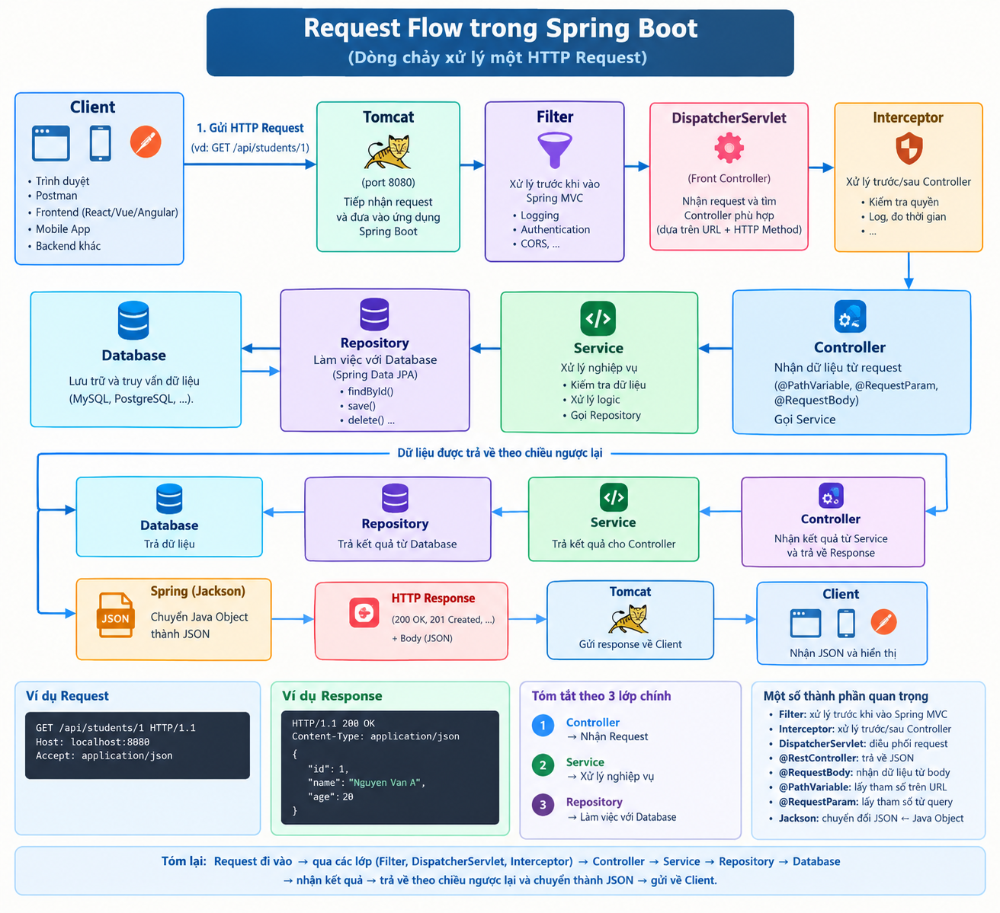

# Hướng dẫn triển khai RESTful API trong Spring Boot

## Bước 1: Tạo project

Vào https://start.spring.io chọn các dependency: **Spring Web, Spring Data JPA, MySQL Driver, Lombok, Validation**. Tải về và mở bằng IDE.

**Tác dụng:** Spring Initializr tạo sẵn cấu trúc project và các thư viện cần thiết, không phải tự cấu hình pom.xml từ đầu.

## Bước 2: Cấu hình database

File `application.properties`:

```properties
spring.datasource.url=jdbc:mysql://localhost:3306/demo_db
spring.datasource.username=root
spring.datasource.password=123456
spring.jpa.hibernate.ddl-auto=update
```

**Tác dụng:**

- `datasource.url`: chỉ định database cần kết nối
- `username/password`: thông tin đăng nhập MySQL
- `ddl-auto=update`: tự động tạo/cập nhật bảng từ Entity, không cần viết SQL thủ công

## Bước 3: Tạo Entity

```java
@Entity
@Table(name = "products")
@Getter @Setter @NoArgsConstructor @AllArgsConstructor @Builder
public class Product {
    @Id
    @GeneratedValue(strategy = GenerationType.IDENTITY)
    private Long id;
    private String name;
    private Double price;
    private Integer quantity;
}
```

**Tác dụng:**

- `@Entity`: đánh dấu class ánh xạ với bảng trong database
- `@Table`: đặt tên bảng
- `@Id` + `@GeneratedValue`: khóa chính tự tăng
- Lombok `@Getter/@Setter/@Builder`: tự sinh getter, setter, builder, giảm code lặp

## Bước 4: Tạo Repository

```java
@Repository
public interface ProductRepository extends JpaRepository<Product, Long> {
}
```

**Tác dụng:** Spring Data JPA tự sinh sẵn các phương thức `findAll()`, `findById()`, `save()`, `deleteById()`, `existsById()`. Không cần viết code truy vấn.

## Bước 5: Tạo DTO

```java
@Getter @Setter
public class ProductRequest {
    @NotBlank(message = "Ten khong duoc de trong")
    private String name;
    @Min(value = 0, message = "Gia phai >= 0")
    private Double price;
    private Integer quantity;
}
```

**Tác dụng:**

- Tách dữ liệu nhận vào khỏi Entity, tránh lộ thông tin nội bộ
- `@NotBlank`, `@Min`: validate dữ liệu đầu vào, tự trả lỗi 400 nếu sai

## Bước 6: Tạo Service

```java
@Service
@RequiredArgsConstructor
public class ProductServiceImpl implements ProductService {

    private final ProductRepository productRepository;

    public List<Product> getAll() {
        return productRepository.findAll();
    }

    public Product getById(Long id) {
        return productRepository.findById(id)
                .orElseThrow(() -> new RuntimeException("Khong tim thay"));
    }

    public Product create(Product product) {
        return productRepository.save(product);
    }

    public void delete(Long id) {
        productRepository.deleteById(id);
    }
}
```

**Tác dụng:**

- `@Service`: đánh dấu đây là tầng nghiệp vụ, Spring tự tạo bean
- `@RequiredArgsConstructor`: Lombok tự inject các dependency qua constructor
- Tách logic nghiệp vụ khỏi Controller, dễ test và tái sử dụng

## Bước 7: Tạo Controller

```java
@RestController
@RequestMapping("/api/v1/products")
@RequiredArgsConstructor
public class ProductController {

    private final ProductService productService;

    @GetMapping
    public List<Product> getAll() {
        return productService.getAll();
    }

    @GetMapping("/{id}")
    public Product getById(@PathVariable Long id) {
        return productService.getById(id);
    }

    @PostMapping
    @ResponseStatus(HttpStatus.CREATED)
    public Product create(@Valid @RequestBody Product product) {
        return productService.create(product);
    }

    @PutMapping("/{id}")
    public Product update(@PathVariable Long id, @Valid @RequestBody Product product) {
        product.setId(id);
        return productService.create(product);
    }

    @DeleteMapping("/{id}")
    @ResponseStatus(HttpStatus.NO_CONTENT)
    public void delete(@PathVariable Long id) {
        productService.delete(id);
    }
}
```

**Tác dụng:**

- `@RestController`: nhận request HTTP và trả về JSON tự động
- `@RequestMapping`: định nghĩa URL gốc cho tất cả endpoint
- `@GetMapping/@PostMapping/@PutMapping/@DeleteMapping`: ánh xạ phương thức HTTP với method Java
- `@PathVariable`: lấy giá trị từ URL (`/products/1`)
- `@RequestBody`: chuyển JSON body thành object Java
- `@Valid`: kích hoạt validate DTO
- `@ResponseStatus`: trả về mã HTTP phù hợp (201 khi tạo, 204 khi xóa)

## Bước 8: Xử lý lỗi tập trung

```java
@RestControllerAdvice
public class GlobalExceptionHandler {

    @ExceptionHandler(RuntimeException.class)
    public ResponseEntity<Map<String, Object>> handle(RuntimeException ex) {
        return ResponseEntity.status(HttpStatus.NOT_FOUND)
                .body(Map.of("message", ex.getMessage()));
    }
}
```

**Tác dụng:**

- `@RestControllerAdvice`: bắt exception từ mọi Controller
- `@ExceptionHandler`: chỉ định loại exception cần xử lý
- Trả về JSON lỗi thống nhất thay vì stack trace mặc định

## Bước 9: Chạy ứng dụng

```bash
mvn spring-boot:run
```

Hoặc chạy file `DemoApplication.java` trong IDE. Server khởi động ở port 8080.

## Bước 10: Kiểm thử API

```bash
# Tạo sản phẩm
curl -X POST http://localhost:8080/api/v1/products \
  -H "Content-Type: application/json" \
  -d '{"name":"Laptop","price":1500,"quantity":10}'

# Lấy danh sách
curl http://localhost:8080/api/v1/products

# Lấy theo ID
curl http://localhost:8080/api/v1/products/1

# Xóa
curl -X DELETE http://localhost:8080/api/v1/products/1
```

## Tóm tắt luồng xử lý

```
Client (JSON)
    -> Controller (nhận request, validate, trả response)
    -> Service (xử lý nghiệp vụ)
    -> Repository (truy vấn database)
    -> Entity (ánh xạ bảng)
    -> Database
```

**Vai trò từng tầng:**

| Tầng              | Vai trò                                       |
| ----------------- | --------------------------------------------- |
| Controller        | Nhận request HTTP, không chứa logic nghiệp vụ |
| Service           | Xử lý nghiệp vụ, tái sử dụng được             |
| Repository        | Giao tiếp database, không viết SQL thủ công   |
| Entity            | Ánh xạ bảng database với class Java           |
| DTO               | Trao đổi dữ liệu với client, validate đầu vào |
| Exception Handler | Trả lỗi thống nhất cho client                 |

Cách tổ chức này giúp code rõ ràng, dễ bảo trì, dễ test và mở rộng về sau.

# JPA là gì? Hibernate là gì?

## 1. JPA (Java Persistence API)

### Định nghĩa

JPA là **đặc tả (specification)** của Java, định nghĩa **cách thức chuẩn** để ánh xạ object Java với bảng trong database quan hệ. Nó chỉ là **bộ interface và annotation**, không phải thư viện chạy được.

Nói cách khác: JPA quy định "phải làm gì", nhưng không quy định "làm như thế nào".

### JPA nằm ở đâu?

JPA là một phần của **Jakarta EE** (trước đây là Java EE). Package chính là `jakarta.persistence.*`.

### JPA cung cấp gì?

**Annotation để ánh xạ:**

```java
@Entity          // Đánh dấu class là entity
@Table           // Ánh xạ với bảng
@Id              // Khóa chính
@Column          // Ánh xạ với cột
@OneToMany       // Quan hệ 1-nhiều
@ManyToOne       // Quan hệ nhiều-1
```

**Interface để thao tác:**

- `EntityManager` - quản lý entity
- `EntityManagerFactory` - tạo EntityManager
- `Query` - thực thi truy vấn
- `EntityTransaction` - quản lý transaction

### Ví dụ code dùng JPA thuần

```java
EntityManagerFactory emf = Persistence.createEntityManagerFactory("myUnit");
EntityManager em = emf.createEntityManager();

em.getTransaction().begin();
Product p = new Product();
p.setName("Laptop");
em.persist(p);       // INSERT
em.getTransaction().commit();

em.close();
emf.close();
```

### Vấn đề của JPA

JPA chỉ là **đặc tả**, không thể chạy trực tiếp. Muốn dùng phải có **implementation** (thư viện cụ thể hiện thực JPA). Các implementation phổ biến:

- **Hibernate** (phổ biến nhất)
- EclipseLink
- OpenJPA
- DataNucleus

## 2. Hibernate

### Định nghĩa

Hibernate là **ORM framework** (Object-Relational Mapping) - một **implementation cụ thể của JPA**. Nó là thư viện thực sự chạy, làm tất cả công việc ngầm: sinh SQL, kết nối DB, quản lý transaction, cache, lazy loading...

### Hibernate làm gì?

**Ánh xạ object <-> bảng:**

```java
Product product = new Product();  // Object Java
product.setName("Laptop");
session.save(product);            // Hibernate tự sinh: INSERT INTO products...
```

**Tự sinh SQL:** bạn chỉ thao tác với object, Hibernate tự viết SQL.

**Quản lý connection pool, transaction, cache.**

**Hỗ trợ HQL (Hibernate Query Language):** truy vấn bằng object thay vì SQL.

```java
String hql = "FROM Product WHERE price > :price";
List<Product> list = session.createQuery(hql)
    .setParameter("price", 1000)
    .list();
```

### Hibernate có trước JPA

Hibernate ra đời **trước JPA**. Khi chưa có chuẩn JPA, Hibernate có API riêng (`Session`, `SessionFactory`, `Configuration`). Sau khi JPA ra đời, Hibernate trở thành một implementation của JPA và bổ sung thêm API JPA (`EntityManager`...).

## 3. Mối quan hệ giữa JPA và Hibernate

```
        JPA (đặc tả / interface)
        jakarta.persistence.*
                |
                | (được hiện thực bởi)
                v
        Hibernate (implementation)
        org.hibernate.*
                |
                | (được dùng qua)
                v
        Spring Data JPA (lớp trừu tượng thêm)
        org.springframework.data.jpa.*
```

**Ví von dễ hiểu:**

- **JPA** giống như **bản thiết kế xe** (quy định có bánh, có động cơ, có vô lăng)
- **Hibernate** giống như **xe Toyota** (một chiếc xe cụ thể theo bản thiết kế đó)
- **Spring Data JPA** giống như **dịch vụ cho thuê xe tự lái** (giúp dùng xe dễ dàng hơn, không phải tự điều khiển từng bộ phận)

## 4. So sánh JPA và Hibernate

| Tiêu chí           | JPA                            | Hibernate                   |
| ------------------ | ------------------------------ | --------------------------- |
| Bản chất           | Đặc tả (specification)         | Thư viện (implementation)   |
| Có chạy được không | Không, chỉ là interface        | Có, chạy thực tế            |
| Package            | `jakarta.persistence.*`        | `org.hibernate.*`           |
| Nhà cung cấp       | Oracle / Eclipse Foundation    | Red Hat                     |
| Vai trò            | Định nghĩa chuẩn               | Hiện thực chuẩn             |
| API chính          | `EntityManager`                | `Session` + `EntityManager` |
| Dependency         | Không cần (đã có trong JDK EE) | Phải thêm vào project       |

## 5. Spring Data JPA

Spring Data JPA là **lớp trừu tượng bọc trên JPA**, giúp việc dùng JPA dễ dàng hơn rất nhiều.

### Không dùng Spring Data JPA (dùng JPA thuần)

```java
@Repository
public class ProductRepositoryImpl {

    @PersistenceContext
    private EntityManager em;

    public Product findById(Long id) {
        return em.find(Product.class, id);
    }

    public List<Product> findAll() {
        return em.createQuery("FROM Product", Product.class).getResultList();
    }

    public Product save(Product product) {
        em.persist(product);
        return product;
    }
}
```

### Dùng Spring Data JPA

```java
@Repository
public interface ProductRepository extends JpaRepository<Product, Long> {
    // Không cần viết gì cả!
}
```

Spring Data JPA **tự sinh toàn bộ code** `findAll()`, `findById()`, `save()`, `deleteById()`... từ interface rỗng.

### Spring Data JPA còn hỗ trợ

**Query method - đặt tên method là Spring tự sinh query:**

**Quy tắc đặt tên**

Cấu trúc chung:

```
findBy + \[Thuộc tính\] + \[Điều kiện\] + \[And/Or\] + \[Thuộc tính\] + \[Điều kiện\]...
```

Trong đó:

- **Tiền tố (prefix):** `findBy`, `getBy`, `readBy`, `queryBy`, `countBy`, `deleteBy`, `existsBy`
- **Thuộc tính (property):** tên field trong Entity, viết hoa chữ đầu
- **Điều kiện (keyword):** `GreaterThan`, `LessThan`, `Containing`, `Like`, `Between`...

```java
List<Product> findByName(String name);
List<Product> findByPriceGreaterThan(Double price);
List<Product> findByNameContainingAndPriceLessThan(String name, Double price);
```

**Query với @Query:**

```java
@Query("SELECT p FROM Product p WHERE p.price > :price")
List<Product> findExpensiveProducts(@Param("price") Double price);
```

**Phân trang, sắp xếp tự động:**

```java
Page<Product> findAll(Pageable pageable);
```

## 6. Trong project Spring Boot dùng cái gì?

Khi thêm dependency:

```xml
<dependency>
    <groupId>org.springframework.boot</groupId>
    <artifactId>spring-boot-starter-data-jpa</artifactId>
</dependency>
```

Spring Boot sẽ tự động kéo theo:

- **Spring Data JPA** (lớp trừu tượng cao nhất)
- **Hibernate** (implementation của JPA)
- **JPA API** (jakarta.persistence)

Luồng hoạt động:

```
Bạn gọi productRepository.findAll()
        |
        v
Spring Data JPA (sinh query từ tên method hoặc dùng có sẵn)
        |
        v
JPA API (EntityManager - interface chuẩn)
        |
        v
Hibernate (thực thi: sinh SQL, kết nối DB, map kết quả)
        |
        v
JDBC Driver (mysql-connector-j)
        |
        v
MySQL Database
```

## 7. Khi nào dùng cái nào?

| Tình huống                              | Dùng gì                                    |
| --------------------------------------- | ------------------------------------------ |
| Làm app Spring Boot thông thường        | Spring Data JPA (đủ 95% nhu cầu)           |
| Cần custom query phức tạp               | Spring Data JPA + `@Query`                 |
| Cần thao tác rất đặc biệt với Hibernate | Dùng trực tiếp `Session` của Hibernate     |
| Không dùng Spring, chỉ Java thuần       | JPA + Hibernate                            |
| Muốn đổi ORM (Hibernate -> EclipseLink) | Chỉ cần đổi dependency, JPA code không đổi |

## 8. Ví dụ cụ thể với project Product

### Entity (dùng annotation của JPA)

```java
@Entity                              // JPA
@Table(name = "products")            // JPA
public class Product {
    @Id                              // JPA
    @GeneratedValue(strategy = GenerationType.IDENTITY)  // JPA
    private Long id;
    private String name;
}
```

Annotation ở đây thuộc **JPA**, nhưng **Hibernate** là thư viện đọc các annotation này để sinh SQL.

### Repository (dùng Spring Data JPA)

```java
public interface ProductRepository extends JpaRepository<Product, Long> {
}
```

Interface này thuộc **Spring Data JPA**.

### Kết quả khi chạy app

Hibernate tự log ra SQL:

```
Hibernate: create table products (
    id bigint not null auto_increment,
    name varchar(255),
    primary key (id)
)

Hibernate: insert into products (name) values (?)
```

Đó chính là **Hibernate đang làm việc**, dù bạn chỉ viết annotation JPA.

## 9. Tóm tắt một câu

- **JPA** = bộ quy tắc/interface chuẩn để ánh xạ object Java với database, không chạy được một mình.
- **Hibernate** = thư viện cụ thể hiện thực JPA, làm hết công việc ngầm.
- **Spring Data JPA** = lớp bọc trên JPA, giúp code ngắn gọn hơn nhiều, là cái bạn dùng trực tiếp trong Spring Boot.

Trong project của bạn: bạn **viết code theo JPA**, **Hibernate chạy ngầm**, **Spring Data JPA giúp đơn giản hóa**. Ba thứ này luôn đi cùng nhau trong Spring Boot.

# Kiến trúc 4 lớp Spring Boot (có định nghĩa + code mẫu)

## 1. Tổng quan kiến trúc

Kiến trúc 4 lớp chia ứng dụng thành 4 tầng theo trách nhiệm. Request đi từ trên xuống, response trả ngược lại:

```
Client
  |
  v
[1] Presentation Layer   (Controller)
  |
  v
[2] Business Layer       (Service)
  |
  v
[3] Persistence Layer    (Repository)
  |
  v
[4] Database Layer       (MySQL)
```

---

## 2. Lớp 1: Presentation Layer (Tầng hiển thị)

### Định nghĩa

Là tầng **tiếp nhận HTTP request từ client** và **trả về HTTP response**. Đây là điểm vào (entry point) của ứng dụng. Tầng này **không chứa logic nghiệp vụ**, chỉ chuyển tiếp dữ liệu cho Service xử lý.

### Thành phần

**Controller** — class có nhiệm vụ ánh xạ URL với phương thức xử lý.

**DTO (Data Transfer Object)** — object dùng để trao đổi dữ liệu giữa client và server.

### Code mẫu

```java
// DTO - du lieu client gui len
public class ProductRequest {
    @NotBlank(message = "Ten khong duoc de trong")
    private String name;
    @Min(value = 0, message = "Gia phai >= 0")
    private Double price;
    // getter, setter
}

// DTO - du lieu tra ve client
public class ProductResponse {
    private Long id;
    private String name;
    private Double price;
    // getter, setter, builder
}
```

```java
// Controller - tiep nhan request, goi service, tra response
@RestController
@RequestMapping("/api/v1/products")
@RequiredArgsConstructor
public class ProductController {

    private final ProductService productService;

    @GetMapping("/{id}")
    public ResponseEntity<ProductResponse> getById(@PathVariable Long id) {
        return ResponseEntity.ok(productService.getById(id));
    }

    @PostMapping
    public ResponseEntity<ProductResponse> create(@Valid @RequestBody ProductRequest request) {
        return new ResponseEntity<>(productService.create(request), HttpStatus.CREATED);
    }
}
```

### Annotation giải thích

| Annotation                     | Định nghĩa                                                      |
| ------------------------------ | --------------------------------------------------------------- |
| `@RestController`              | Đánh dấu class là controller REST, tự chuyển kết quả thành JSON |
| `@RequestMapping`              | Định nghĩa URL gốc cho controller                               |
| `@GetMapping` / `@PostMapping` | Ánh xạ phương thức HTTP                                         |
| `@PathVariable`                | Lấy giá trị từ URL                                              |
| `@RequestBody`                 | Chuyển JSON body thành object Java                              |
| `@Valid`                       | Kích hoạt validate DTO                                          |

---

## 3. Lớp 2: Business Layer (Tầng nghiệp vụ)

### Định nghĩa

Là tầng **xử lý logic nghiệp vụ** của ứng dụng. Nhận dữ liệu từ Controller, áp dụng các quy tắc kinh doanh, phối hợp các Repository, quản lý transaction, rồi trả kết quả về.

### Thành phần

**Service Interface** — định nghĩa hợp đồng (contract) các phương thức nghiệp vụ.

**Service Implementation** — class thực thi interface, chứa code xử lý.

### Code mẫu

```java
// Interface - dinh nghia hop dong
public interface ProductService {
    ProductResponse getById(Long id);
    ProductResponse create(ProductRequest request);
}
```

```java
// Implementation - thuc thi nghiep vu
@Service
@RequiredArgsConstructor
public class ProductServiceImpl implements ProductService {

    private final ProductRepository productRepository;

    @Override
    public ProductResponse getById(Long id) {
        Product product = productRepository.findById(id)
                .orElseThrow(() -> new ResourceNotFoundException("Product", "id", id));
        return toResponse(product);
    }

    @Override
    @Transactional
    public ProductResponse create(ProductRequest request) {
        // Kiem tra nghiep vu: ten khong duoc trung
        if (productRepository.existsByName(request.getName())) {
            throw new BusinessException("Ten san pham da ton tai");
        }

        Product product = Product.builder()
                .name(request.getName())
                .price(request.getPrice())
                .build();

        return toResponse(productRepository.save(product));
    }

    private ProductResponse toResponse(Product p) {
        return ProductResponse.builder()
                .id(p.getId())
                .name(p.getName())
                .price(p.getPrice())
                .build();
    }
}
```

### Annotation giải thích

| Annotation                 | Định nghĩa                                                     |
| -------------------------- | -------------------------------------------------------------- |
| `@Service`                 | Đánh dấu class là bean tầng nghiệp vụ, Spring quản lý vòng đời |
| `@Transactional`           | Bao method trong một transaction, lỗi thì rollback toàn bộ     |
| `@RequiredArgsConstructor` | Lombok tự sinh constructor inject các field final              |

### Vai trò của `@Transactional`

Đảm bảo tính **ACID**. Ví dụ chuyển tiền:

```java
@Transactional
public void transfer(Long fromId, Long toId, Double amount) {
    accountRepo.decrease(fromId, amount);  // buoc 1
    accountRepo.increase(toId, amount);    // buoc 2
    // neu buoc 2 loi, buoc 1 tu dong rollback
}
```

Nếu không có `@Transactional`, bước 1 thành công, bước 2 lỗi → dữ liệu mất cân bằng.

---

## 4. Lớp 3: Persistence Layer (Tầng truy cập dữ liệu)

### Định nghĩa

Là tầng **giao tiếp trực tiếp với database**, chịu trách nhiệm thực hiện các thao tác CRUD (Create, Read, Update, Delete) và truy vấn. Tầng này **không chứa logic nghiệp vụ**.

### Thành phần

**Repository** — interface kế thừa `JpaRepository`, cung cấp sẵn các phương thức CRUD.

**Entity** — class ánh xạ với bảng trong database.

### Code mẫu

```java
// Entity - anh xa bang products
@Entity
@Table(name = "products")
@Getter @Setter @NoArgsConstructor @AllArgsConstructor @Builder
public class Product {

    @Id
    @GeneratedValue(strategy = GenerationType.IDENTITY)
    private Long id;

    @Column(nullable = false)
    private String name;

    private Double price;
}
```

```java
// Repository - truy van database
@Repository
public interface ProductRepository extends JpaRepository<Product, Long> {

    // Query Method: Spring tu sinh SQL
    boolean existsByName(String name);
    List<Product> findByPriceGreaterThan(Double price);

    // Query tu viet
    @Query("SELECT p FROM Product p WHERE p.name LIKE %:keyword%")
    Page<Product> search(@Param("keyword") String keyword, Pageable pageable);
}
```

### Annotation giải thích

| Annotation        | Định nghĩa                                     |
| ----------------- | ---------------------------------------------- |
| `@Entity`         | Đánh dấu class ánh xạ với bảng database        |
| `@Table`          | Chỉ định tên bảng                              |
| `@Id`             | Đánh dấu khóa chính                            |
| `@GeneratedValue` | Khóa chính tự tăng                             |
| `@Column`         | Cấu hình cột (nullable, length...)             |
| `@Repository`     | Đánh dấu là bean tầng truy cập dữ liệu         |
| `@Query`          | Viết câu truy vấn tùy chỉnh (JPQL hoặc native) |
| `@Param`          | Gắn tên tham số cho query                      |

### Vai trò của `JpaRepository`

`JpaRepository<Product, Long>` cung cấp sẵn:

| Method           | SQL tương đương                                  |
| ---------------- | ------------------------------------------------ |
| `findAll()`      | `SELECT * FROM products`                         |
| `findById(id)`   | `SELECT * FROM products WHERE id = ?`            |
| `save(entity)`   | `INSERT` hoặc `UPDATE`                           |
| `deleteById(id)` | `DELETE FROM products WHERE id = ?`              |
| `existsById(id)` | `SELECT COUNT(*) > 0 FROM products WHERE id = ?` |
| `count()`        | `SELECT COUNT(*) FROM products`                  |

---

## 5. Lớp 4: Database Layer (Tầng cơ sở dữ liệu)

### Định nghĩa

Là nơi **lưu trữ dữ liệu thực tế** (MySQL, PostgreSQL, MongoDB...). Tầng này nằm ngoài ứng dụng Java, được truy cập qua JDBC driver.

### Cấu hình

```properties
spring.datasource.url=jdbc:mysql://localhost:3306/demo_db
spring.datasource.username=root
spring.datasource.password=123456
spring.datasource.driver-class-name=com.mysql.cj.jdbc.Driver
spring.jpa.hibernate.ddl-auto=update
spring.jpa.show-sql=true
```

---

## 6. Các thành phần hỗ trợ (không thuộc 4 lớp chính)

### 6.1. Exception Handling (Xử lý lỗi)

**Định nghĩa:** Cơ chế **bắt và xử lý exception tập trung**, trả về response lỗi thống nhất cho client thay vì stack trace mặc định.

```java
// Custom exception
public class ResourceNotFoundException extends RuntimeException {
    public ResourceNotFoundException(String resource, String field, Object value) {
        super(String.format("%s khong tim thay voi %s = '%s'", resource, field, value));
    }
}
```

```java
// Bat exception toan cuc
@RestControllerAdvice
public class GlobalExceptionHandler {

    @ExceptionHandler(ResourceNotFoundException.class)
    public ResponseEntity<Map<String, Object>> handleNotFound(ResourceNotFoundException ex) {
        return ResponseEntity.status(HttpStatus.NOT_FOUND)
                .body(Map.of("message", ex.getMessage()));
    }

    @ExceptionHandler(MethodArgumentNotValidException.class)
    public ResponseEntity<Map<String, String>> handleValidation(MethodArgumentNotValidException ex) {
        Map<String, String> errors = new HashMap<>();
        for (FieldError e : ex.getBindingResult().getFieldErrors()) {
            errors.put(e.getField(), e.getDefaultMessage());
        }
        return ResponseEntity.badRequest().body(errors);
    }
}
```

| Annotation              | Định nghĩa                        |
| ----------------------- | --------------------------------- |
| `@RestControllerAdvice` | Bắt exception từ mọi controller   |
| `@ExceptionHandler`     | Chỉ định loại exception cần xử lý |

### 6.2. Configuration (Cấu hình)

**Định nghĩa:** Class chứa các **bean cấu hình** cho ứng dụng (ví dụ: cấu hình CORS, Security, ModelMapper, Swagger...).

```java
@Configuration
public class AppConfig {

    @Bean
    public ModelMapper modelMapper() {
        return new ModelMapper();
    }
}
```

| Annotation       | Định nghĩa                                    |
| ---------------- | --------------------------------------------- |
| `@Configuration` | Đánh dấu class chứa định nghĩa bean           |
| `@Bean`          | Đánh dấu method trả về bean do Spring quản lý |

### 6.3. Mapper (Chuyển đổi Entity <-> DTO)

**Định nghĩa:** Class chịu trách nhiệm **chuyển đổi qua lại giữa Entity và DTO**, giữ cho Service không phải viết code mapping lặp lại.

```java
@Component
public class ProductMapper {

    public Product toEntity(ProductRequest req) {
        return Product.builder()
                .name(req.getName())
                .price(req.getPrice())
                .build();
    }

    public ProductResponse toResponse(Product p) {
        return ProductResponse.builder()
                .id(p.getId())
                .name(p.getName())
                .price(p.getPrice())
                .build();
    }
}
```

### 6.4. DTO (Data Transfer Object)

**Định nghĩa:** Object **vận chuyển dữ liệu** giữa các tầng hoặc giữa client và server. Tách biệt cấu trúc dữ liệu trao đổi khỏi cấu trúc Entity trong database.

**Tại sao cần DTO?**

| Lý do     | Giải thích                                                         |
| --------- | ------------------------------------------------------------------ |
| Bảo mật   | Không lộ cấu trúc bảng cho client                                  |
| Linh hoạt | Có thể có nhiều DTO cho cùng một Entity (Create, Update, Response) |
| Validate  | Gắn annotation validate trên DTO, không đụng Entity                |
| Tránh lỗi | Không gặp vấn đề lazy loading khi serialize                        |

### 6.5. Dependency Injection (Tiêm phụ thuộc)

**Định nghĩa:** Cơ chế **Spring tự tạo và cung cấp các object phụ thuộc** cho class cần dùng, thay vì class phải tự `new`.

```java
// Khong dung DI - phai tu new, kho test
public class ProductController {
    private ProductService service = new ProductServiceImpl();
}
```

```java
// Dung DI - Spring tu inject
@RestController
@RequiredArgsConstructor
public class ProductController {
    private final ProductService productService;
}
```

| Cách inject                              | Khi nào dùng                    |
| ---------------------------------------- | ------------------------------- |
| Constructor (`@RequiredArgsConstructor`) | Khuyến nghị, dễ test, immutable |
| Setter                                   | Khi dependency có thể thay đổi  |
| Field (`@Autowired`)                     | Không khuyến nghị, khó test     |

---

## 7. So sánh code sai vs code đúng

### Code sai - Controller truy cập database trực tiếp

```java
@RestController
public class ProductController {

    @Autowired
    private ProductRepository productRepository;  // Sai: vuot tang

    @PostMapping("/products")
    public Product create(@RequestBody Product product) {  // Sai: dung Entity lam DTO
        return productRepository.save(product);           // Sai: khong validate, khong nghiep vu
    }
}
```

**Vấn đề:**

- Controller gọi Repository → bỏ qua tầng Service
- Dùng Entity trực tiếp → lộ cấu trúc DB
- Không có validate, không có nghiệp vụ
- Không kiểm soát transaction

### Code đúng - Chia đúng 4 lớp

```java
// Controller: chi nhan va tra
@PostMapping
public ResponseEntity<ProductResponse> create(@Valid @RequestBody ProductRequest req) {
    return new ResponseEntity<>(productService.create(req), HttpStatus.CREATED);
}

// Service: xu ly nghiep vu
@Transactional
public ProductResponse create(ProductRequest req) {
    if (productRepository.existsByName(req.getName())) {
        throw new BusinessException("Ten da ton tai");
    }
    return mapper.toResponse(productRepository.save(mapper.toEntity(req)));
}

// Repository: truy van
boolean existsByName(String name);
Product save(Product product);
```

---

## 8. Ưu và nhược điểm

### Ưu điểm

| Ưu điểm               | Giải thích                                   |
| --------------------- | -------------------------------------------- |
| Tách biệt trách nhiệm | Mỗi lớp làm một việc, dễ hiểu                |
| Dễ test               | Có thể mock từng lớp để test riêng           |
| Dễ bảo trì            | Sửa một lớp không ảnh hưởng lớp khác         |
| Dễ mở rộng            | Thêm chức năng chỉ cần thêm method đúng lớp  |
| Tái sử dụng           | Service dùng được cho cả REST API và gRPC    |
| Linh hoạt             | Đổi MySQL sang PostgreSQL chỉ sửa Repository |

### Nhược điểm

| Nhược điểm       | Giải thích                                  |
| ---------------- | ------------------------------------------- |
| Nhiều code       | Phải viết DTO, mapper, service interface    |
| Boilerplate      | Nhiều lớp trung gian cho chức năng đơn giản |
| Over-engineering | Project nhỏ không cần chia 4 lớp            |

**Với project nhỏ (dưới 20 API)**, có thể gộp Controller + Service. **Với project lớn hoặc làm việc nhóm**, 4 lớp là chuẩn nên theo.

---

## 9. Tóm tắt một câu

**Kiến trúc 4 lớp** chia code thành **Presentation (Controller nhận request) → Business (Service xử lý nghiệp vụ) → Persistence (Repository truy vấn) → Database (lưu trữ)**. Mỗi lớp chỉ làm đúng việc của mình, không nhảy cóc, giúp code rõ ràng, dễ test, dễ bảo trì và mở rộng.

Request flow (dòng chảy xử lý request)

# Request Flow

## 1. Request Flow là gì?

**Request Flow** là quá trình một HTTP Request đi từ Client vào ứng dụng Spring Boot, được xử lý qua các thành phần khác nhau, sau đó tạo ra HTTP Response trả về cho Client.

Có thể hình dung đơn giản:

## 

## 2. Ví dụ Request

Giả sử Client gửi request:

```http
GET /api/students/1
```

Request này có nghĩa:

> Lấy thông tin sinh viên có `id = 1`.

Spring Boot sẽ xử lý request theo nhiều bước.

---

## 3. Bước 1: Client gửi HTTP Request

Client có thể là:

- Trình duyệt
- Postman
- Frontend React/Vue/Angular
- Mobile App
- Một Backend khác

Ví dụ:

```http
GET http://localhost:8080/api/students/1
```

Request có thể chứa:

```text
HTTP Method
URL
Headers
Query Parameters
Request Body
```

Ví dụ:

```http
GET /api/students/1 HTTP/1.1
Host: localhost:8080
Accept: application/json
```

---

## 4. Bước 2: Request đi vào Server

Spring Boot thường chạy trên **Tomcat**.

Ví dụ:

```text
localhost:8080
```

Khi request đến:

```text
Client
   ↓
Tomcat :8080
```

Tomcat chịu trách nhiệm tiếp nhận HTTP request và chuyển request vào ứng dụng Spring.

Có thể hiểu đơn giản:

```text
Tomcat
    ↓
Tiếp nhận HTTP Request
    ↓
Chuyển cho Spring
```

---

## 5. Bước 3: DispatcherServlet tiếp nhận Request

Đây là thành phần rất quan trọng trong Spring MVC.

```text
Client
   ↓
Tomcat
   ↓
DispatcherServlet
```

`DispatcherServlet` là **Front Controller** của Spring MVC.

Nó có nhiệm vụ điều phối request đến Controller phù hợp.

Ví dụ request:

```text
GET /api/students/1
```

DispatcherServlet sẽ tìm xem Controller nào xử lý URL này.

---

## 6. Bước 4: Tìm Controller phù hợp

Giả sử chúng ta có:

```java
@RestController
@RequestMapping("/api/students")
public class StudentController {

    @GetMapping("/{id}")
    public Student getStudent(@PathVariable Long id) {
        return studentService.getStudent(id);
    }
}
```

Request:

```text
GET /api/students/1
```

sẽ được ánh xạ đến:

```java
getStudent(1)
```

Quá trình này gọi là **Request Mapping**.

Có thể hình dung:

```text
GET /api/students/1
        ↓
DispatcherServlet
        ↓
StudentController
        ↓
getStudent(1)
```

---

## 7. Bước 5: Controller xử lý Request

Controller nhận dữ liệu từ request.

Ví dụ:

```java
@GetMapping("/{id}")
public Student getStudent(@PathVariable Long id) {

    return studentService.getStudent(id);
}
```

Ở đây:

```java
@PathVariable Long id
```

lấy:

```text
/api/students/1
              ↑
             id=1
```

Sau đó Controller gọi Service:

```java
studentService.getStudent(id);
```

Controller thường không nên chứa quá nhiều logic nghiệp vụ.

Nó chủ yếu làm nhiệm vụ:

```text
Nhận Request
    ↓
Lấy dữ liệu từ Request
    ↓
Gọi Service
    ↓
Trả Response
```

---

## 8. Bước 6: Service xử lý nghiệp vụ

Service chứa logic nghiệp vụ của ứng dụng.

```java
@Service
public class StudentService {

    private final StudentRepository studentRepository;

    public StudentService(StudentRepository studentRepository) {
        this.studentRepository = studentRepository;
    }

    public Student getStudent(Long id) {
        return studentRepository.findById(id)
                .orElse(null);
    }
}
```

Controller:

```text
Controller
    ↓
studentService.getStudent(1)
```

Service:

```text
Service
    ↓
studentRepository.findById(1)
```

---

## 9. Bước 7: Repository truy vấn Database

Repository làm việc với Database.

Ví dụ:

```java
@Repository
public interface StudentRepository
        extends JpaRepository<Student, Long> {

}
```

Service gọi:

```java
studentRepository.findById(1);
```

Spring Data JPA sẽ thực hiện truy vấn Database tương ứng.

Có thể hình dung:

```text
Service
   ↓
Repository
   ↓
Database
```

Database trả về:

```text
Student
id = 1
name = "Nguyen Van A"
age = 20
```

---

## 10. Bước 8: Database trả dữ liệu ngược lên

Sau khi Database tìm thấy dữ liệu:

```text
Database
    ↓
Repository
    ↓
Service
    ↓
Controller
```

Ví dụ:

```java
Student student = studentRepository.findById(id)
        .orElse(null);
```

Service trả `student` về Controller.

Controller:

```java
@GetMapping("/{id}")
public Student getStudent(@PathVariable Long id) {
    return studentService.getStudent(id);
}
```

sẽ trả về:

```java
Student
```

---

## 11. Bước 9: Spring chuyển Object thành JSON

Vì Controller là:

```java
@RestController
```

Spring sẽ chuyển Java Object thành JSON.

Java Object:

```java
Student(
    1,
    "Nguyen Van A",
    20
)
```

được chuyển thành:

```json
{
  "id": 1,
  "name": "Nguyen Van A",
  "age": 20
}
```

Jackson thường đảm nhiệm việc chuyển đổi này.

---

## 12. Bước 10: Response trả về Client

Cuối cùng:

```text
Controller
    ↓
Spring
    ↓
HTTP Response
    ↓
Tomcat
    ↓
Client
```

Response có thể là:

```http
HTTP/1.1 200 OK
Content-Type: application/json
```

Body:

```json
{
  "id": 1,
  "name": "Nguyen Van A",
  "age": 20
}
```

---

## 13. Toàn bộ Request Flow

Có thể ghi nhớ bằng sơ đồ:

```text
                  REQUEST
                     ↓
                  Client
                     ↓
                   Tomcat
                     ↓
             DispatcherServlet
                     ↓
              Controller
                     ↓
                Service
                     ↓
               Repository
                     ↓
                 Database
                     ↓
               Repository
                     ↓
                 Service
                     ↓
                Controller
                     ↓
              JSON Response
                     ↓
                   Client
```

---

# Cấu hình DataSource

## 1. DataSource là gì?

**DataSource** là **cái quản lý kết nối đến MySQL** cho ứng dụng Spring Boot.

Thay vì mỗi lần query phải mở kết nối mới (tốn thời gian), DataSource **giữ sẵn một số kết nối** trong "pool", khi cần thì lấy ra dùng, xong trả lại.

```
Spring Boot  -->  [DataSource: pool 10 ket noi]  -->  MySQL
```

**Lợi ích:**

- Nhanh (không mở kết nối mới mỗi lần)
- Giới hạn số kết nối, tránh MySQL quá tải
- Tự động quản lý, không cần code thủ công

---

## 2. Cấu hình cơ bản (chỉ cần 4 dòng)

Trong `application.properties`:

```properties
spring.datasource.url=jdbc:mysql://localhost:3306/demo_db
spring.datasource.username=root
spring.datasource.password=123456
spring.datasource.driver-class-name=com.mysql.cj.jdbc.Driver
```

**Spring Boot tự làm hết:**

- Đọc 4 dòng trên
- Tạo DataSource bean
- Cấu hình connection pool (mặc định dùng **HikariCP**)
- Kết nối vào MySQL

**Không cần viết code Java.**

---

## 3. Giải thích từng dòng

```properties
spring.datasource.url=jdbc:mysql://localhost:3306/demo_db
```

- `jdbc:mysql://` — dùng MySQL
- `localhost` — MySQL chạy trên máy mình
- `3306` — port mặc định của MySQL
- `demo_db` — tên database

```properties
spring.datasource.username=root
spring.datasource.password=123456
```

- Tài khoản đăng nhập MySQL (bạn tự đặt khi cài MySQL)

```properties
spring.datasource.driver-class-name=com.mysql.cj.jdbc.Driver
```

- Driver để Java nói chuyện với MySQL
- Thực ra Spring Boot **tự nhận diện** từ URL, dòng này có thể bỏ qua

---

## 4. HikariCP là gì?

**HikariCP** là thư viện **quản lý pool kết nối** mà Spring Boot dùng mặc định. Bạn không cần cài gì, thêm dependency `spring-boot-starter-data-jpa` là có sẵn.

**Pool hoạt động thế nào:**

```
Ung dung can query
    -> Lay 1 ket noi tu pool
    -> Dung xong, tra lai pool
    -> Pool giu ket noi do cho lan sau
```

---

## 5. Cấu hình HikariCP (tùy chọn)

Mặc định đã đủ dùng. Chỉ cần thêm khi muốn tinh chỉnh:

```properties
spring.datasource.hikari.maximum-pool-size=10
spring.datasource.hikari.minimum-idle=5
spring.datasource.hikari.connection-timeout=30000
```

| Thông số             | Ý nghĩa                     | Mặc định |
| -------------------- | --------------------------- | -------- |
| `maximum-pool-size`  | Số kết nối tối đa           | 10       |
| `minimum-idle`       | Số kết nối luôn giữ sẵn     | 10       |
| `connection-timeout` | Chờ lấy kết nối tối đa (ms) | 30000    |

**Với project học tập, không cần thêm gì.** Mặc định chạy tốt.

---

## 6. Ví dụ đầy đủ cho project của bạn

```properties
# Ket noi MySQL
spring.datasource.url=jdbc:mysql://localhost:3306/demo_db?useSSL=false&serverTimezone=UTC&allowPublicKeyRetrieval=true
spring.datasource.username=root
spring.datasource.password=123456

# JPA tu tao bang
spring.jpa.hibernate.ddl-auto=update
spring.jpa.show-sql=true
```

**Lưu ý về URL:**

- `useSSL=false` — tắt SSL cho đơn giản khi dev
- `serverTimezone=UTC` — tránh lỗi múi giờ
- `allowPublicKeyRetrieval=true` — cần cho MySQL 8

---

## 7. Kiểm tra đã kết nối thành công

Khi chạy app, xem log:

**Thành công:**

```
HikariPool-1 - Start completed.
Tomcat started on port 8080
```

**Thất bại:**

| Log lỗi                               | Nguyên nhân                          |
| ------------------------------------- | ------------------------------------ |
| `Access denied for user`              | Sai username/password                |
| `Unknown database 'demo_db'`          | Chưa tạo database                    |
| `Communications link failure`         | MySQL chưa chạy                      |
| `Public Key Retrieval is not allowed` | Thiếu `allowPublicKeyRetrieval=true` |

---

## 8. Cấu hình theo môi trường (dev / prod)

Tách ra 2 file để không lộ mật khẩu khi deploy.

**`application-dev.properties`** (dùng khi code):

```properties
spring.datasource.url=jdbc:mysql://localhost:3306/demo_db
spring.datasource.username=root
spring.datasource.password=123456
spring.jpa.show-sql=true
```

**`application-prod.properties`** (dùng khi deploy):

```properties
spring.datasource.url=jdbc:mysql://server-that:3306/demo_db
spring.datasource.username=${DB_USERNAME}
spring.datasource.password=${DB_PASSWORD}
spring.jpa.show-sql=false
```

**`application.properties`** (chọn mặc định dùng dev):

```properties
spring.profiles.active=dev
```

**Chạy production:**

```bash
java -jar app.jar --spring.profiles.active=prod
```

`${DB_USERNAME}` sẽ đọc từ biến môi trường, không lộ mật khẩu trong file.

---

## 9. Tóm tắt

**DataSource** = cái quản lý kết nối đến MySQL.

**Cấu hình chỉ cần 3 dòng** (driver có thể bỏ):

```properties
spring.datasource.url=jdbc:mysql://localhost:3306/demo_db
spring.datasource.username=root
spring.datasource.password=123456
```

**Spring Boot tự làm hết:**

- Tạo DataSource
- Dùng HikariCP làm pool
- Kết nối MySQL

**Nhớ 3 điểm:**

1. Chỉ cần khai báo `spring.datasource.*`, không viết code Java
2. HikariCP là pool mặc định, không cần cấu hình thêm khi học
3. Dùng `${DB_PASSWORD}` và profile khi deploy production

# Các Annotation quan trọng trong Spring Boot

## 1. Nhóm Annotation định nghĩa Bean (Spring quản lý)

Spring Boot dùng các annotation này để **đánh dấu class là bean** và tự tạo object, inject vào nơi cần dùng.

### 1.1. `@RestController`

**Định nghĩa:** Đánh dấu class là **controller REST**, nhận HTTP request và trả về JSON.

**Bản chất:** Là kết hợp của `@Controller` + `@ResponseBody`. Mọi method trong class tự động chuyển kết quả thành JSON.

```java
@RestController
@RequestMapping("/api/v1/products")
public class ProductController {

    @GetMapping("/{id}")
    public Product getById(@PathVariable Long id) {
        return productService.getById(id);  // Tu dong thanh JSON
    }
}
```

**So sánh với `@Controller`:**

| `@Controller`                        | `@RestController`          |
| ------------------------------------ | -------------------------- |
| Trả về tên view (HTML)               | Trả về JSON                |
| Cần `@ResponseBody` trên từng method | Tự động có `@ResponseBody` |
| Dùng cho web truyền thống            | Dùng cho REST API          |

---

### 1.2. `@Service`

**Định nghĩa:** Đánh dấu class thuộc **tầng nghiệp vụ** (business layer).

**Bản chất:** Chỉ là `@Component` đổi tên cho dễ đọc. Spring tạo 1 instance duy nhất (singleton) và inject khi cần.

```java
@Service
@RequiredArgsConstructor
public class ProductServiceImpl implements ProductService {

    private final ProductRepository productRepository;

    @Transactional
    public ProductResponse create(ProductRequest request) {
        // Xu ly nghiep vu
    }
}
```

**Tại sao cần `@Service` thay vì `@Component`?**

- Đọc code biết ngay đây là tầng nghiệp vụ
- Tách biệt về mặt ý nghĩa với các tầng khác

---

### 1.3. `@Repository`

**Định nghĩa:** Đánh dấu class/interface thuộc **tầng truy cập dữ liệu** (persistence layer).

**Bản chất:** Là `@Component` + **tự động dịch exception** của database thành `DataAccessException` của Spring.

```java
@Repository
public interface ProductRepository extends JpaRepository<Product, Long> {
    List<Product> findByName(String name);
}
```

**Điểm đặc biệt:** Khi database ném lỗi (ví dụ `SQLException`), Spring tự bọc thành `DataAccessException` — exception chuẩn, không phụ thuộc database.

---

### 1.4. Bảng so sánh 3 annotation

| Annotation        | Tầng         | Ý nghĩa                                  |
| ----------------- | ------------ | ---------------------------------------- |
| `@RestController` | Presentation | Nhận HTTP request                        |
| `@Service`        | Business     | Xử lý nghiệp vụ                          |
| `@Repository`     | Persistence  | Truy vấn database                        |
| `@Component`      | Bất kỳ       | Bean dùng chung, không thuộc tầng cụ thể |

Cả 4 đều khiến Spring tạo bean và inject. Chỉ khác nhau về **ý nghĩa ngữ nghĩa**.

---

## 2. Nhóm Annotation ánh xạ Database (JPA)

### 2.1. `@Entity`

**Định nghĩa:** Đánh dấu class ánh xạ với **một bảng trong database**.

**Bản chất:** Hibernate đọc class này lúc khởi động để biết cần tạo/cập nhật bảng nào.

```java
@Entity
public class Product {

    @Id
    @GeneratedValue(strategy = GenerationType.IDENTITY)
    private Long id;

    private String name;
}
```

**Yêu cầu bắt buộc:**

- Phải có `@Id`
- Phải có constructor không tham số
- Không nên là `final`

---

### 2.2. `@Table`

**Định nghĩa:** Chỉ định **tên bảng** trong database mà Entity ánh xạ tới.

**Bản chất:** Nếu không có `@Table`, Hibernate dùng tên class viết thường (Product → `product`).

```java
@Entity
@Table(name = "products")
public class Product {
    // Anh xa bang "products" thay vi "product"
}
```

**Một số thuộc tính:**

| Thuộc tính          | Ý nghĩa            |
| ------------------- | ------------------ |
| `name`              | Tên bảng           |
| `schema`            | Schema chứa bảng   |
| `uniqueConstraints` | Ràng buộc duy nhất |
| `indexes`           | Tạo index          |

---

### 2.3. `@Id`

**Định nghĩa:** Đánh dấu field là **khóa chính** của bảng.

**Bản chất:** Hibernate dùng field này làm định danh duy nhất cho mỗi record.

```java
@Id
private Long id;
```

**Bắt buộc:** Mỗi `@Entity` phải có đúng 1 field `@Id`.

---

### 2.4. `@GeneratedValue`

**Định nghĩa:** Chỉ định **cách sinh giá trị** cho khóa chính.

```java
@Id
@GeneratedValue(strategy = GenerationType.IDENTITY)
private Long id;
```

**Các chiến lược:**

| Strategy   | Ý nghĩa                           | Dùng với           |
| ---------- | --------------------------------- | ------------------ |
| `IDENTITY` | Database tự tăng (AUTO_INCREMENT) | MySQL, PostgreSQL  |
| `SEQUENCE` | Dùng sequence                     | Oracle, PostgreSQL |
| `TABLE`    | Dùng bảng riêng để đếm            | Mọi DB             |
| `AUTO`     | Hibernate tự chọn                 | Mọi DB             |

**Với MySQL:** dùng `IDENTITY`.

---

### 2.5. `@Column`

**Định nghĩa:** Cấu hình chi tiết cho **cột** trong bảng.

```java
@Column(name = "product_name", nullable = false, length = 100)
private String name;
```

| Thuộc tính         | Ý nghĩa                  |
| ------------------ | ------------------------ |
| `name`             | Tên cột trong DB         |
| `nullable`         | Cho phép NULL không      |
| `length`           | Độ dài tối đa (varchar)  |
| `unique`           | Giá trị duy nhất         |
| `columnDefinition` | Định nghĩa SQL tùy chỉnh |

Nếu không có `@Column`, Hibernate dùng tên field làm tên cột.

---

### 2.6. Ví dụ Entity hoàn chỉnh

```java
@Entity
@Table(name = "products")
@Getter @Setter @NoArgsConstructor @AllArgsConstructor @Builder
public class Product {

    @Id
    @GeneratedValue(strategy = GenerationType.IDENTITY)
    private Long id;

    @Column(name = "name", nullable = false, length = 100)
    private String name;

    @Column(name = "price", nullable = false)
    private Double price;

    @Column(name = "quantity")
    private Integer quantity;
}
```

---

## 3. Annotation Transaction

### 3.1. `@Transactional`

**Định nghĩa:** Bao method trong **một transaction**. Nếu có lỗi, toàn bộ thay đổi sẽ bị **rollback** (hoàn tác).

**Bản chất:** Spring dùng AOP (Aspect-Oriented Programming) để tự mở transaction trước khi method chạy và commit/rollback sau khi method kết thúc.

```java
@Service
public class OrderService {

    @Transactional
    public void createOrder(OrderRequest request) {
        orderRepository.save(order);           // Buoc 1
        productRepository.decreaseStock(...);  // Buoc 2
        // Neu buoc 2 loi -> buoc 1 cung bi rollback
    }
}
```

**Không có `@Transactional`:**

```
Buoc 1: save order       -> Thanh cong
Buoc 2: decrease stock   -> Loi
Ket qua: order da luu nhung stock chua tru -> Du lieu sai
```

**Có `@Transactional`:**

```
Buoc 1: save order       -> Tam luu
Buoc 2: decrease stock   -> Loi
Ket qua: rollback ca 2 -> Du lieu nguyen ven
```

**Vị trí đặt:**

| Vị trí      | Phạm vi                       |
| ----------- | ----------------------------- |
| Trên method | Chỉ method đó                 |
| Trên class  | Mọi method public trong class |

**Lưu ý quan trọng:**

- Chỉ hoạt động với method `public`
- Không hoạt động khi gọi nội bộ (method trong cùng class gọi nhau)
- Mặc định chỉ rollback với `RuntimeException`, muốn rollback với `Exception` phải chỉ định

```java
@Transactional(rollbackFor = Exception.class)
```

---

## 4. Annotation truy vấn

### 4.1. `@Query`

**Định nghĩa:** Viết **câu truy vấn tùy chỉnh** thay vì để Spring tự sinh từ tên method.

**Có 2 loại:**

**JPQL (mặc định)** — dùng tên Entity và field:

```java
@Query("SELECT p FROM Product p WHERE p.price > :price")
List<Product> findExpensive(@Param("price") Double price);
```

**Native Query** — dùng SQL thuần:

```java
@Query(value = "SELECT * FROM products WHERE price > :price", nativeQuery = true)
List<Product> findExpensive(@Param("price") Double price);
```

**Giải thích:**

- `:price` — tham số động
- `@Param("price")` — gắn tham số method với `:price`
- `nativeQuery = true` — dùng SQL thuần

---

### 4.2. `@Param`

**Định nghĩa:** Gắn **tên tham số** cho câu query.

```java
@Query("SELECT p FROM Product p WHERE p.name = :name AND p.price > :price")
List<Product> find(@Param("name") String name, @Param("price") Double price);
```

Không có `@Param`, phải dùng vị trí `?1`, `?2` — khó đọc hơn.

---

### 4.3. `@Modifying`

**Định nghĩa:** Đánh dấu query là **UPDATE hoặc DELETE** (thay đổi dữ liệu).

**Bắt buộc** phải có khi dùng `@Query` với UPDATE/DELETE, nếu không Spring sẽ báo lỗi.

```java
@Modifying
@Transactional
@Query("UPDATE Product p SET p.price = :price WHERE p.id = :id")
int updatePrice(@Param("id") Long id, @Param("price") Double price);
```

Phải đi kèm `@Transactional`.

---

## 5. Annotation nhận dữ liệu từ request

### 5.1. `@PathVariable`

**Định nghĩa:** Lấy giá trị từ **URL path**.

```java
@GetMapping("/products/{id}")
public Product getById(@PathVariable Long id) { ... }
```

Request `GET /products/5` → `id = 5`.

---

### 5.2. `@RequestParam`

**Định nghĩa:** Lấy giá trị từ **query string**.

```java
@GetMapping("/products")
public List<Product> getAll(
    @RequestParam(defaultValue = "0") int page,
    @RequestParam(defaultValue = "10") int size) { ... }
```

Request `GET /products?page=1&size=20` → `page = 1, size = 20`.

---

### 5.3. `@RequestBody`

**Định nghĩa:** Lấy dữ liệu từ **body** của request (thường là JSON) và chuyển thành object Java.

```java
@PostMapping("/products")
public Product create(@RequestBody ProductRequest request) { ... }
```

Body `{"name": "Laptop", "price": 1500}` → object `ProductRequest`.

---

### 5.4. `@RequestHeader`

**Định nghĩa:** Lấy giá trị từ **HTTP header**.

```java
@GetMapping("/profile")
public User getProfile(@RequestHeader("Authorization") String token) { ... }
```

---

### 5.5. Bảng tóm tắt

| Annotation       | Lấy từ đâu   | Ví dụ                       |
| ---------------- | ------------ | --------------------------- |
| `@PathVariable`  | URL path     | `/products/{id}`            |
| `@RequestParam`  | Query string | `?page=0&size=10`           |
| `@RequestBody`   | Body JSON    | `{"name": "Laptop"}`        |
| `@RequestHeader` | HTTP header  | `Authorization: Bearer ...` |

---

## 6. Annotation định nghĩa URL

### 6.1. `@RequestMapping`

**Định nghĩa:** Ánh xạ URL với class hoặc method Controller.

```java
@RestController
@RequestMapping("/api/v1/products")
public class ProductController { ... }
```

Mọi method trong class đều có prefix `/api/v1/products`.

---

### 6.2. `@GetMapping`, `@PostMapping`, `@PutMapping`, `@DeleteMapping`

**Định nghĩa:** Ánh xạ URL với **phương thức HTTP cụ thể**.

```java
@GetMapping("/{id}")      // GET /products/1
@PostMapping              // POST /products
@PutMapping("/{id}")      // PUT /products/1
@DeleteMapping("/{id}")   // DELETE /products/1
```

**Tương đương với `@RequestMapping(method = RequestMethod.GET)`** nhưng ngắn gọn hơn.

---

## 7. Annotation Validate

### 7.1. `@Valid`

**Định nghĩa:** Kích hoạt **kiểm tra dữ liệu** trên object được đánh dấu.

```java
@PostMapping
public Product create(@Valid @RequestBody ProductRequest request) { ... }
```

Nếu dữ liệu sai → Spring ném `MethodArgumentNotValidException` → trả về 400.

---

### 7.2. Các annotation validate trong DTO

```java
public class ProductRequest {

    @NotBlank(message = "Ten khong duoc de trong")
    private String name;

    @NotNull(message = "Gia khong duoc de trong")
    @Min(value = 0, message = "Gia phai >= 0")
    private Double price;

    @Email(message = "Email khong hop le")
    private String email;

    @Size(min = 5, max = 100, message = "Do dai 5-100 ky tu")
    private String description;
}
```

| Annotation      | Kiểm tra                                   |
| --------------- | ------------------------------------------ |
| `@NotNull`      | Không được null                            |
| `@NotBlank`     | Không null, không rỗng, không khoảng trắng |
| `@NotEmpty`     | Không null, không rỗng                     |
| `@Min` / `@Max` | Giá trị nhỏ nhất / lớn nhất                |
| `@Size`         | Độ dài chuỗi/collection                    |
| `@Email`        | Định dạng email                            |
| `@Pattern`      | Khớp regex                                 |

---

## 8. Annotation Exception Handling

### 8.1. `@RestControllerAdvice`

**Định nghĩa:** Đánh dấu class **xử lý exception tập trung** cho mọi Controller.

```java
@RestControllerAdvice
public class GlobalExceptionHandler {
    // Cac method xu ly exception
}
```

---

### 8.2. `@ExceptionHandler`

**Định nghĩa:** Chỉ định **loại exception** mà method sẽ xử lý.

```java
@ExceptionHandler(ResourceNotFoundException.class)
public ResponseEntity<Map<String, Object>> handleNotFound(ResourceNotFoundException ex) {
    return ResponseEntity.status(HttpStatus.NOT_FOUND)
            .body(Map.of("message", ex.getMessage()));
}
```

Khi bất kỳ Controller nào ném `ResourceNotFoundException`, method này sẽ bắt và trả response.

---

## 9. Annotation Dependency Injection

### 9.1. `@Autowired`

**Định nghĩa:** Yêu cầu Spring **tự inject dependency** vào field/setter/constructor.

```java
@Autowired
private ProductService productService;
```

**Không khuyến nghị** dùng trên field vì khó test. Nên dùng constructor.

---

### 9.2. `@RequiredArgsConstructor` (Lombok)

**Định nghĩa:** Lombok tự sinh **constructor** cho các field `final`.

```java
@Service
@RequiredArgsConstructor
public class ProductServiceImpl {

    private final ProductRepository productRepository;
    private final ProductMapper productMapper;

    // Lombok tu sinh:
    // public ProductServiceImpl(ProductRepository repo, ProductMapper mapper) {
    //     this.productRepository = repo;
    //     this.productMapper = mapper;
    // }
}
```

Spring thấy constructor này → tự inject → **không cần `@Autowired`**.

**Cách này được khuyến nghị** vì: field `final` (immutable), dễ test, không phụ thuộc Spring.

---

### 9.3. `@Configuration` và `@Bean`

**Định nghĩa:**

- `@Configuration`: đánh dấu class chứa định nghĩa bean
- `@Bean`: đánh dấu method trả về bean cho Spring quản lý

```java
@Configuration
public class AppConfig {

    @Bean
    public ModelMapper modelMapper() {
        return new ModelMapper();
    }
}
```

Dùng khi cần tạo bean từ **thư viện bên ngoài** (không thể sửa code thêm `@Component`).

---

## 10. Bảng tổng hợp nhanh

| Annotation                 | Nhóm        | Nhiệm vụ                 |
| -------------------------- | ----------- | ------------------------ |
| `@RestController`          | Bean        | Đánh dấu Controller REST |
| `@Service`                 | Bean        | Đánh dấu tầng nghiệp vụ  |
| `@Repository`              | Bean        | Đánh dấu tầng truy vấn   |
| `@Component`               | Bean        | Bean dùng chung          |
| `@Configuration`           | Bean        | Class cấu hình           |
| `@Bean`                    | Bean        | Method tạo bean          |
| `@Entity`                  | JPA         | Ánh xạ class với bảng    |
| `@Table`                   | JPA         | Đặt tên bảng             |
| `@Id`                      | JPA         | Khóa chính               |
| `@GeneratedValue`          | JPA         | Cách sinh khóa chính     |
| `@Column`                  | JPA         | Cấu hình cột             |
| `@Transactional`           | Transaction | Quản lý transaction      |
| `@Query`                   | Query       | Viết query tùy chỉnh     |
| `@Param`                   | Query       | Đặt tên tham số query    |
| `@Modifying`               | Query       | Đánh dấu UPDATE/DELETE   |
| `@PathVariable`            | Request     | Lấy từ URL               |
| `@RequestParam`            | Request     | Lấy từ query string      |
| `@RequestBody`             | Request     | Lấy từ body JSON         |
| `@RequestHeader`           | Request     | Lấy từ header            |
| `@RequestMapping`          | URL         | Ánh xạ URL               |
| `@GetMapping`              | URL         | Ánh xạ GET               |
| `@PostMapping`             | URL         | Ánh xạ POST              |
| `@PutMapping`              | URL         | Ánh xạ PUT               |
| `@DeleteMapping`           | URL         | Ánh xạ DELETE            |
| `@Valid`                   | Validate    | Kích hoạt validate       |
| `@NotNull`, `@NotBlank`... | Validate    | Ràng buộc dữ liệu        |
| `@RestControllerAdvice`    | Exception   | Xử lý lỗi tập trung      |
| `@ExceptionHandler`        | Exception   | Bắt exception cụ thể     |
| `@Autowired`               | DI          | Tự inject dependency     |
| `@RequiredArgsConstructor` | DI          | Lombok sinh constructor  |

---

## 11. Ví dụ đầy đủ dùng nhiều annotation

```java
// Entity
@Entity
@Table(name = "products")
@Getter @Setter @NoArgsConstructor @AllArgsConstructor @Builder
public class Product {
    @Id
    @GeneratedValue(strategy = GenerationType.IDENTITY)
    private Long id;

    @Column(nullable = false, length = 100)
    private String name;

    @Column(nullable = false)
    private Double price;
}
```

```java
// Repository
@Repository
public interface ProductRepository extends JpaRepository<Product, Long> {

    @Query("SELECT p FROM Product p WHERE p.price > :price")
    List<Product> findExpensive(@Param("price") Double price);

    @Modifying
    @Transactional
    @Query("UPDATE Product p SET p.price = :price WHERE p.id = :id")
    int updatePrice(@Param("id") Long id, @Param("price") Double price);
}
```

```java
// DTO
@Getter @Setter
public class ProductRequest {
    @NotBlank(message = "Ten khong duoc de trong")
    private String name;

    @NotNull
    @Min(value = 0, message = "Gia phai >= 0")
    private Double price;
}
```

```java
// Service
@Service
@RequiredArgsConstructor
public class ProductServiceImpl implements ProductService {

    private final ProductRepository productRepository;

    @Override
    @Transactional
    public ProductResponse create(ProductRequest request) {
        Product product = Product.builder()
                .name(request.getName())
                .price(request.getPrice())
                .build();
        return toResponse(productRepository.save(product));
    }
}
```

```java
// Controller
@RestController
@RequestMapping("/api/v1/products")
@RequiredArgsConstructor
public class ProductController {

    private final ProductService productService;

    @GetMapping("/{id}")
    public ResponseEntity<ProductResponse> getById(@PathVariable Long id) {
        return ResponseEntity.ok(productService.getById(id));
    }

    @PostMapping
    public ResponseEntity<ProductResponse> create(@Valid @RequestBody ProductRequest request) {
        return new ResponseEntity<>(productService.create(request), HttpStatus.CREATED);
    }
}
```

```java
// Exception Handler
@RestControllerAdvice
public class GlobalExceptionHandler {

    @ExceptionHandler(ResourceNotFoundException.class)
    public ResponseEntity<Map<String, Object>> handleNotFound(ResourceNotFoundException ex) {
        return ResponseEntity.status(HttpStatus.NOT_FOUND)
                .body(Map.of("message", ex.getMessage()));
    }
}
```

---

## 12. Tóm tắt

**Nhớ 6 nhóm chính:**

1. **Bean** — `@RestController`, `@Service`, `@Repository`, `@Component`
2. **JPA** — `@Entity`, `@Table`, `@Id`, `@Column`
3. **Transaction** — `@Transactional`
4. **Query** — `@Query`, `@Param`, `@Modifying`
5. **Request** — `@PathVariable`, `@RequestParam`, `@RequestBody`
6. **Validate** — `@Valid`, `@NotNull`, `@Min`...

**Quy tắc vàng:** Annotation không làm gì cả — chúng chỉ là **dấu hiệu** để Spring/Hibernate biết phải làm gì. Hiểu annotation = hiểu Spring Boot làm gì ngầm.
